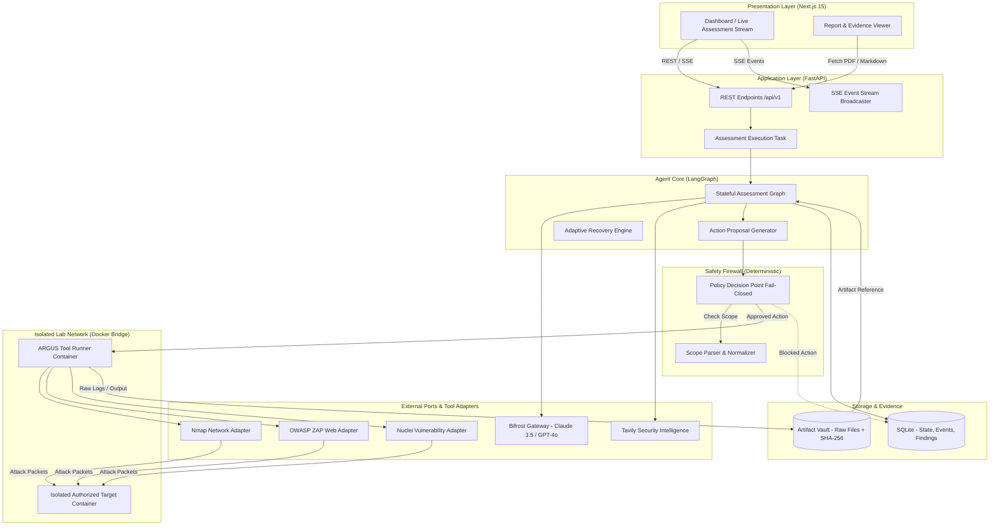
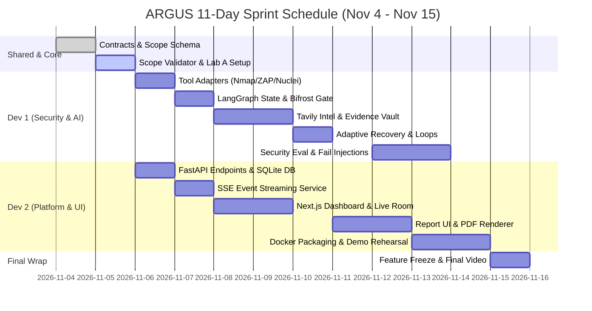

# ARGUS — Autonomous Penetration Testing Platform
## MVP Architecture Specification & Product Blueprint (Track A — Challenge 03)

**Document Status:** Gated Specification (Phase 1: Specify)  
**Target Event:** Geek Room / Global AI Hackathon 2026 (Track A: Challenge 03 — Autonomous Pentesting Agent)  
**Timeline:** 1–15 November 2026 submission window (implementation sprint 4–15 November 2026)  
**Team Composition:** 2 Engineers (Dev 1: Security Engine & LangGraph / Dev 2: Platform, API & Dashboard)  
**Target Environment:** macOS (Apple Silicon M1 Pro, 16 GB RAM) + Docker Desktop Isolated Runtime  
**Mandatory Integrations:** Bifrost (Maxim AI) & Tavily Search API  
**Core Slogan:** *"Autonomous Security Testing. Verified by Evidence."*

---

## Assumptions Surfaced Immediately

> [!IMPORTANT]
> The following architectural and operational assumptions govern this specification. If any assumption conflicts with your goals, clarify before proceeding to Phase 2:
> 1. **Architecture Style:** ARGUS is built strictly as a **Modular Monolith** (FastAPI backend + single stateful LangGraph agent loop + Next.js web dashboard + SQLite/file-based evidence vault). Distributed microservices, Celery/Redis workers, and multi-agent swarms are intentionally omitted to guarantee high delivery confidence within 11 days on a 16 GB M1 Pro machine.
> 2. **Execution Environment:** Security tools (Nmap, OWASP ZAP, Nuclei) execute inside a dedicated, isolated Docker container attached to a user-defined Docker bridge network (`argus-lab-net`). No direct arbitrary shell execution is ever granted to the LLM.
> 3. **Deterministic Safety:** Scope compliance is enforced by deterministic Python code before any tool command is dispatched, backed by Docker network egress rules. LLM judgment is **never** used to decide whether an action is in-scope.
> 4. **Hardware Footprint:** All local LLMs and heavy Kali desktop VMs are avoided. LLM intelligence is consumed via Bifrost (Maxim AI) accessing cloud frontier models (e.g., Claude 3.5 Sonnet / GPT-4o), ensuring the 16 GB M1 Pro runs smoothly with low memory pressure.
> 5. **Evidence Over Hallucination:** A finding reported by a scanner is strictly classified as `POTENTIAL` until a deterministic verification adapter reproduces the behavior with captured raw evidence.

---

## 1. Objective & Product Vision

### 1.1 The Problem & Hackathon Opportunity
Most autonomous pentesting hackathon submissions fail because:
1. **They are shallow LLM wrappers:** They pass 5,000 lines of raw scanner output directly to an LLM, which hallucinates vulnerabilities and makes up CVEs.
2. **They violate scope:** They allow the LLM to run arbitrary bash commands or follow external links, leading to immediate disqualification.
3. **They are brittle:** Any failed tool execution, timeout, or model rate limit causes the agent to crash or enter infinite loops.
4. **They lack verifiable proof:** Reports present unverified claims without raw cryptographic logs or clear reproduction steps.

### 1.2 The ARGUS Winning Moat
ARGUS wins Challenge 03 by delivering an enterprise-grade autonomous assessment lifecycle that judges can trust:
- **Zero Out-of-Scope Guarantee:** A two-tier scope firewall (Python policy engine + Docker network containment) that renders out-of-scope actions physically impossible.
- **Evidence-Backed Verification:** Every finding is linked to an immutable SHA-256 hashed artifact. Scanner results are labeled `POTENTIAL` until an active verification check elevates them to `CONFIRMED`.
- **Adaptive Resilience:** When a scan times out or a tool crashes, ARGUS captures the error, replans its test approach, falls back to alternative tools, and switches LLM providers via Bifrost without user intervention.
- **Deep Sponsor Synergies:**
  - **Bifrost (Maxim AI):** Serves as the mission-critical model gateway providing automatic fallback (Claude 3.5 Sonnet $\rightarrow$ GPT-4o), token/cost tracking, latency telemetry, and budget limits displayed live in the dashboard.
  - **Tavily:** Conducts targeted vulnerability and remediation research on specific discovered service versions (e.g. `Apache 2.4.49`), feeding authoritative CVE citations and vendor patches into the final executive report.

### 1.3 The 3-Minute Hackathon Winning Live Demo Path
1. **Minute 1 — Scope Ingestion & Safety Proof:**
   - Judge supplies an unseen lab target (`http://lab-target:8080`) and uploads a strict scope YAML.
   - The user tries to add an unauthorized IP (`10.0.0.99`); ARGUS flags the conflict and blocks execution.
   - The user clicks **Launch Assessment**. Scope is validated, and the assessment moves to `RUNNING`.
2. **Minute 2 — Autonomous Recon, Intel & Adaptive Recovery:**
   - Live SSE feed streams real-time events to the Next.js dashboard.
   - ARGUS runs Nmap, normalizes the services, calls Tavily to research detected versions, and plans targeted checks.
   - **Injected Failure Demo:** A simulated tool timeout triggers. ARGUS detects the failure, catches the error code, replans via an alternative adapter, and switches Bifrost model routes seamlessly.
3. **Minute 3 — Verifiable Proof & Executive Report:**
   - ARGUS executes a targeted Nuclei template, verifies the vulnerability, hashes the HTTP request/response artifact (`sha256:7f8a...`), and promotes the finding from `POTENTIAL` to `CONFIRMED`.
   - The assessment terminates cleanly at the objective.
   - Judge clicks **Download Report** — instantly receiving a PDF containing an Executive Summary, Discovered Topology, Verified Findings with cryptographic evidence links, and Tavily-sourced Remediation Steps.

---

## 2. Phase 0: Capability Map & Module Boundaries

The ARGUS system decomposes into 10 decoupled, independently testable capabilities:

| Module ID | Responsibility | Dependencies | Output Interface |
|---|---|---|---|
| `core-scope` | Scope YAML parsing, CIDR/FQDN normalization, deterministic policy engine, rate/time validation. | *None* | `ScopeValidator`, `PolicyEngine` |
| `evidence-vault` | File-based raw artifact storage, SHA-256 integrity hashing, metadata tracking, credential redaction. | *None* | `EvidenceStore`, `ArtifactMetadata` |
| `bifrost-gateway` | Maxim AI Bifrost LLM proxy, multi-provider routing (Claude/GPT), automatic failover, cost/token metrics. | *None* | `BifrostClient`, `CompletionResponse` |
| `tavily-intel` | Target technology CVE/NVD intelligence gathering, authoritative security advisory retrieval, citation linkage. | *None* | `TavilyClient`, `SecurityAdvisory` |
| `tool-engine` | Docker sandboxed execution, typed command builders, subprocess lifecycle, output parsers (Nmap, ZAP, Nuclei). | `core-scope`, `evidence-vault` | `ToolRegistry`, `ToolAdapter`, `NormalizedObservation` |
| `finding-verifier` | 4-state finding classification (`POTENTIAL`, `CONFIRMED`, `REJECTED`, `UNVERIFIABLE`), verification tests, evidence association. | `evidence-vault`, `tavily-intel` | `FindingVerifier`, `Finding` |
| `agent-orchestrator`| LangGraph state machine, typed action proposals, adaptive replan loop, bounded error recovery. | `core-scope`, `tool-engine`, `bifrost-gateway`, `finding-verifier` | `AssessmentGraph`, `AssessmentState` |
| `api-lifecycle` | FastAPI REST endpoints, Server-Sent Events (SSE) broadcaster, SQLite database persistence, background runner. | `agent-orchestrator`, `core-scope`, `evidence-vault` | FastAPI App, OpenAPI schema |
| `report-engine` | Client-ready report compilation (Markdown & PDF), topology diagrams, verified finding cards, Tavily remediation. | `finding-verifier`, `evidence-vault`, `api-lifecycle` | `ReportGenerator`, `PDFRenderer` |
| `dashboard-ui` | Next.js 15 App Router web application, live SSE event stream, interactive topology graph, evidence inspector. | `api-lifecycle` | React App, Web Interface |

### Build Order:
```
core-scope ──┐
             ├─→ tool-engine ──┐
evidence-vault ────────────────┼─→ agent-orchestrator ──→ api-lifecycle ──┬─→ dashboard-ui
bifrost-gateway ───────────────┤                                          └─→ report-engine
tavily-intel ──→ finding-verifier ─┘
```

---

## 3. System Architecture & High-Level Design

### 3.1 Architecture Overview
ARGUS uses a **Ports-and-Adapters Modular Monolith** pattern:
- **Core Domain:** LangGraph agent orchestrator, Scope Policy engine, and Finding Verifier.
- **Inbound Ports:** FastAPI HTTP REST API & Server-Sent Events (SSE).
- **Outbound Ports (Adapters):** Docker Security Tool Adapters (Nmap, ZAP, Nuclei), Bifrost Model Gateway, Tavily Security Intel, SQLite Database, and Local Artifact Filesystem.



### 3.2 Security Containment Model
1. **Level 1 (Application Gating):** Before any subprocess or socket call is executed, `PolicyEngine.evaluate(action)` inspects target IP, FQDN, destination port, transport protocol, and action category against the active scope document. If unapproved, the action is aborted immediately with reason recorded in SQLite.
2. **Level 2 (Network Containment):** Tool containers run within a dedicated Docker bridge network (`argus-net`). Default gateway egress to the public internet is disabled (`internal: true` or iptables egress drop), except for controlled host DNS resolution. The only routable destinations are explicitly declared lab containers.

---

## 4. Agent Design & LangGraph State Machine

### 4.1 Orchestration Pattern
ARGUS avoids multi-agent swarm chaos by using a single **Deterministic-Governed Stateful Graph**. The LLM never has raw terminal access; it only selects typed operations from an allowlisted registry.

```mermaid
flowchart TD
    START([Start Assessment]) --> V_SCOPE[Validate Scope]
    V_SCOPE -->|Scope Invalid| STOP_ERR([Stop: Invalid Scope])
    V_SCOPE -->|Scope Valid| RECON[Run Reconnaissance (Nmap)]
    
    RECON --> NORM[Normalize Observations]
    NORM --> INTEL[Tavily Intel Gathering]
    
    INTEL --> PLAN[Propose Next Action]
    PLAN --> GATE{Policy Engine Check}
    
    GATE -->|Denied| BLOCKED[Record Blocked Action]
    BLOCKED --> EVAL{Objective Met or Limits Reached?}
    
    GATE -->|Approved| EXEC[Execute Registered Tool]
    EXEC --> PARSE[Parse & Store Raw Evidence]
    
    PARSE -->|Tool Failed / Timeout| RECOVER[Adaptive Recovery & Replan]
    RECOVER --> PLAN
    
    PARSE -->|Success| VERIFY[Finding Verifier]
    VERIFY --> EVAL
    
    EVAL -->|No: Next Iteration| PLAN
    EVAL -->|Yes: Goal Met / Budget Exceeded| REPORT[Compile Final Report]
    REPORT --> DONE([Assessment Completed])
```

### 4.2 State Schema (`AssessmentState`)
```python
from typing import TypedDict, List, Dict, Any, Optional


class AssessmentState(TypedDict):
    assessment_id: str
    target: Dict[str, Any]  # {"type": "web" | "network", "value": "http://lab:8080"}
    scope_id: str
    scope_version: str
    status: str  # DRAFT | VALIDATING | READY | RUNNING | COMPLETED | FAILED

    # Topology & Recon Data
    discovered_assets: List[str]  # ["192.168.50.2", "web.lab.local"]
    discovered_services: List[
        Dict[str, Any]
    ]  # [{"port": 80, "service": "http", "version": "Apache 2.4.49"}]
    observations: List[Dict[str, Any]]  # Normalized observation structures
    research_refs: List[Dict[str, Any]]  # Tavily retrieved CVE articles & advisories

    # Planning & Execution State
    test_plan: List[Dict[str, Any]]
    current_action: Optional[Dict[str, Any]]
    executed_actions: List[Dict[str, Any]]
    blocked_actions: List[Dict[str, Any]]

    # Findings & Integrity
    evidence_refs: List[Dict[str, Any]]  # Hashed references to raw disk logs
    findings: List[Dict[str, Any]]  # Verified & potential findings

    # Execution Budgets & Recovery
    current_iteration: int
    max_iterations: int
    started_at: str
    deadline_at: Optional[str]
    consecutive_failures: int
    last_error: Optional[Dict[str, Any]]
    stop_reason: Optional[str]
```

### 4.3 Node Definitions & Responsibilities
1. `validate_scope_node`: Parses scope YAML, verifies expiry date, validates CIDR/IP formats, checks target inclusion.
2. `recon_node`: Executes non-intrusive discovery (`nmap -sV -T4 -p-`) against authorized targets.
3. `normalize_observations_node`: Transforms raw tool outputs (XML, JSON, text) into standard internal JSON observations.
4. `tavily_intel_node`: Queries Tavily for specific software versions detected in recon (e.g. `query="Apache 2.4.49 vulnerabilities CVE NVD advisory"`). Filters and stores sources.
5. `plan_action_node`: Sends normalized observations, current findings, and lab objective to Bifrost (Claude 3.5 Sonnet). Returns a typed `ActionProposal`.
6. `policy_check_node`: Evaluates `ActionProposal` against `PolicyEngine`. Emits `action_approved` or `action_blocked` SSE event.
7. `execute_tool_node`: Invokes registered adapter in Docker container, enforcing strict per-tool timeouts (e.g. 120s). Captures stdout, stderr, exit code.
8. `verify_finding_node`: If tool output indicates a vulnerability, triggers the verification logic. If reproducible, creates finding with status `CONFIRMED`; otherwise `POTENTIAL`.
9. `recovery_node`: Classifies failure (timeout, non-zero exit, parse failure, Bifrost outage). Backs off, switches tool parameters or falls back to secondary LLM via Bifrost.
10. `report_node`: Aggregates graph state, builds executive summary, maps findings to MITRE ATT&CK / OWASP Top 10, compiles markdown, triggers PDF generation.

---

## 5. Scope & Safety Policy Engine

### 5.1 Scope Document Schema (`scope.yaml`)
```yaml
schema_version: "1.0"
assessment_id: "asm-20261104-001"
name: "GeekRoom Hackathon Authorized Lab"
created_at: "2026-11-04T12:00:00Z"
expires_at: "2026-11-05T12:00:00Z"

targets:
  allowed_hosts:
    - "192.168.100.5"
    - "lab-target.local"
  allowed_subnets:
    - "192.168.100.0/28"
  denied_hosts:
    - "192.168.100.1"          # Lab Gateway
    - "169.254.169.254"         # Cloud Metadata

ports:
  allowed_ports: [80, 443, 8080, 8443, 22]
  denied_ports: [25, 445, 3389]

protocols:
  allowed: ["http", "https", "tcp"]
  denied: ["udp", "icmp", "dns-zone-transfer"]

actions:
  allowed_categories:
    - "network_recon"
    - "web_crawl"
    - "passive_vuln_scan"
    - "active_template_check"
  prohibited_categories:
    - "denial_of_service"
    - "brute_force_credentials"
    - "arbitrary_command_injection"
    - "lateral_movement"
    - "privilege_escalation"

rate_limits:
  max_requests_per_second: 20
  max_concurrency: 2
  tool_timeout_seconds: 180
  redirect_policy: "strict_same_host" # Block any redirect outside allowed_hosts
```

### 5.2 Deterministic Policy Logic (`policy_engine.py`)
```python
class PolicyEngine:
    def __init__(self, scope: ScopeDocument):
        self.scope = scope

    def evaluate(self, proposal: ActionProposal) -> PolicyDecision:
        # 1. Temporal Check
        if datetime.utcnow() > self.scope.expires_at:
            return PolicyDecision(approved=False, reason="Scope authorization has expired.")

        # 2. Target IP & Hostname Gating
        target_ip = self._resolve_and_verify_ip(proposal.target_host)
        if not target_ip or not self._is_ip_in_scope(target_ip):
            return PolicyDecision(
                approved=False,
                reason=f"Target {proposal.target_host} ({target_ip}) is out of scope.",
            )

        # 3. Port Allowlist Check
        if proposal.target_port not in self.scope.ports.allowed_ports:
            return PolicyDecision(
                approved=False, reason=f"Port {proposal.target_port} is not permitted."
            )

        # 4. Action Category & Tool Allowlist Check
        if proposal.action_category in self.scope.actions.prohibited_categories:
            return PolicyDecision(
                approved=False, reason=f"Action category {proposal.action_category} is prohibited."
            )
        if proposal.action_category not in self.scope.actions.allowed_categories:
            return PolicyDecision(
                approved=False,
                reason=f"Action category {proposal.action_category} not in allowed list.",
            )

        # 5. Dangerous Command Argument Scrubbing
        if not self._validate_tool_arguments(proposal.tool_name, proposal.arguments):
            return PolicyDecision(
                approved=False, reason="Arguments contain forbidden flags or malformed patterns."
            )

        return PolicyDecision(approved=True, reason="Authorized by scope policy.")
```

---

## 6. Tool Engine & Security Adapters

### 6.1 Abstract Base Tool Adapter
Every security tool runs through a standardized interface that enforces isolated execution, timeout tracking, and raw log emission:

```python
from abc import ABC, abstractmethod
from pydantic import BaseModel
from typing import Dict, Any, List


class NormalizedObservation(BaseModel):
    tool: str
    target: str
    observation_type: str  # host_discovery | open_port | service_version | vuln_signature
    data: Dict[str, Any]
    severity_hint: Optional[str]
    raw_evidence_id: str


class ToolAdapter(ABC):
    @property
    @abstractmethod
    def tool_name(self) -> str:
        pass

    @abstractmethod
    def validate_args(self, args: Dict[str, Any]) -> bool:
        """Ensure no shell injection or forbidden arguments are present."""
        pass

    @abstractmethod
    def build_command(self, args: Dict[str, Any]) -> List[str]:
        """Construct the execution command array (never raw shell string)."""
        pass

    @abstractmethod
    def parse_output(self, raw_output: str, evidence_id: str) -> List[NormalizedObservation]:
        """Normalize tool output into typed domain observations."""
        pass
```

### 6.2 Registered MVP Tool Adapters
1. **Nmap Adapter (`nmap`):**
   - Commands: `nmap -sV -sT -T4 --open -oX /output/scan.xml <target_ip> -p <ports>`
   - Flags enforced: No raw sockets (`-sT` unprivileged TCP connect), XML output mandated for deterministic parsing via `defusedxml`.
2. **OWASP ZAP Adapter (`zap`):**
   - Mode: ZAP Baseline scan running inside Docker via standard API.
   - Passive inspection: Detects missing security headers, cookie flags (HttpOnly/Secure), CORS misconfigurations, directory indexing.
3. **Nuclei Adapter (`nuclei`):**
   - Command: `nuclei -u <target_url> -t <pinned_template_dir> -j -silent`
   - Scope: Strictly pinned, non-destructive, informational and CVE templates only. Output parsed line-by-line JSONL.

---

## 7. Evidence Vault & Finding Verifier

### 7.1 Cryptographic Evidence Store (`evidence_vault.py`)
To prevent the common hackathon pitfall of "invented" findings:
- All raw stdout, stderr, HTTP request/response dumps, and scanner output files are saved under `/artifacts/{assessment_id}/{evidence_id}.raw`.
- Each file has an immutable SHA-256 calculated on write:
```python
class EvidenceArtifact(BaseModel):
    evidence_id: str  # e.g., "ev-20261104-a1b2c3"
    assessment_id: str
    tool_name: str
    tool_version: str
    command_executed: str
    sha256: str  # Cryptographic integrity digest
    file_path: str
    captured_at: datetime
    content_type: str  # "application/xml", "application/json", "text/plain"
    redacted: bool  # True if passwords/tokens were detected and masked
```

### 7.2 Finding Verification Engine (`finding_verifier.py`)
Vulnerabilities move through an explicit state machine:

```
[Raw Tool Output] ──→ POTENTIAL ──┬─→ [Reproduced by Verification Test] ──→ CONFIRMED
                                  ├─→ [Contradicted / False Positive]    ──→ REJECTED
                                  └─→ [Requires Destructive / Blocked]  ──→ UNVERIFIABLE
```

1. **POTENTIAL:** A scanner reported a signature, or Tavily matched a CVE to a version string.
2. **CONFIRMED:** An active verification check succeeded (e.g. Nuclei template executed and confirmed response pattern, or HTTP status and proof-of-concept matched non-destructively). Linked to specific `evidence_ids`.
3. **REJECTED:** Secondary probe demonstrated the endpoint is patched, returns 404, or the detection was a false positive.
4. **UNVERIFIABLE:** Exploitation requires prohibited actions (e.g., DoS, brute force) or authentication credentials not in scope.

---

## 8. Sponsor Integrations Architecture

### 8.1 Bifrost Gateway (Maxim AI)
ARGUS does not call OpenAI or Anthropic SDKs directly. All requests pass through the Bifrost proxy gateway (`bifrost.maxim.ai` or self-hosted Bifrost instance):

```python
class BifrostClient:
    """Enterprise model gateway integration supporting multi-provider fallback and cost auditing."""

    def __init__(
        self, api_key: str, default_model: str = "claude-3-5-sonnet", fallback_model: str = "gpt-4o"
    ):
        self.api_key = api_key
        self.default_model = default_model
        self.fallback_model = fallback_model
        self.metrics = {"tokens_prompt": 0, "tokens_completion": 0, "fallback_triggered": False}

    async def complete_structured(self, prompt: str, schema: Type[BaseModel]) -> BaseModel:
        # Route through Bifrost with auto-fallback configuration
        headers = {
            "Authorization": f"Bearer {self.api_key}",
            "X-Bifrost-Fallback": self.fallback_model,
        }
        # Logs latency, provider name, and cost per call into SQLite assessment_events
```

**Judge Appeal:** The Next.js dashboard features a dedicated **Bifrost Telemetry Bar** showing real-time token count, latency per inference step, active model provider, and whether a fallback was triggered.

### 8.2 Tavily Security Intelligence
When recon discovers an exposed service and version (e.g. `ProFTPD 1.3.5` or `Apache Struts 2.3.15`), Tavily is invoked with precision security queries:
- Query format: `site:cve.mitre.org OR site:nvd.nist.gov OR site:exploit-db.com "ProFTPD 1.3.5" vulnerability`
- Tavily returns authoritative source URLs, publication dates, and CVE numbers.
- **Evidence Separation:** Tavily outputs are tagged as `EXTERNAL_INTEL`, preventing external CVE descriptions from being conflated with target-verified evidence.
- **Remediation Grounding:** Official vendor patches and CVE mitigations from Tavily are automatically embedded into Section 6 of the PDF report.

---

## 9. Data Model & Persistence (SQLite)

The persistence layer uses SQLite with Foreign Key constraints enabled and WAL (Write-Ahead Logging) mode for concurrent access:

```sql
CREATE TABLE assessments (
    id TEXT PRIMARY KEY,
    name TEXT NOT NULL,
    status TEXT NOT NULL, -- DRAFT, RUNNING, COMPLETED, FAILED, PAUSED
    target_type TEXT NOT NULL,
    target_value TEXT NOT NULL,
    scope_document TEXT NOT NULL,
    objective TEXT NOT NULL,
    created_at TIMESTAMP DEFAULT CURRENT_TIMESTAMP,
    completed_at TIMESTAMP
);

CREATE TABLE assessment_events (
    id TEXT PRIMARY KEY,
    assessment_id TEXT NOT NULL REFERENCES assessments(id) ON DELETE CASCADE,
    event_type TEXT NOT NULL, -- scope_validated, action_approved, tool_started, finding_detected, etc.
    payload TEXT NOT NULL,
    timestamp TIMESTAMP DEFAULT CURRENT_TIMESTAMP
);

CREATE TABLE evidence_artifacts (
    id TEXT PRIMARY KEY,
    assessment_id TEXT NOT NULL REFERENCES assessments(id) ON DELETE CASCADE,
    tool_name TEXT NOT NULL,
    sha256 TEXT NOT NULL,
    file_path TEXT NOT NULL,
    captured_at TIMESTAMP DEFAULT CURRENT_TIMESTAMP
);

CREATE TABLE findings (
    id TEXT PRIMARY KEY,
    assessment_id TEXT NOT NULL REFERENCES assessments(id) ON DELETE CASCADE,
    title TEXT NOT NULL,
    severity TEXT NOT NULL, -- INFORMATIONAL, LOW, MEDIUM, HIGH, CRITICAL
    status TEXT NOT NULL,   -- POTENTIAL, CONFIRMED, REJECTED, UNVERIFIABLE
    verification_method TEXT,
    affected_asset TEXT NOT NULL,
    remediation TEXT,
    created_at TIMESTAMP DEFAULT CURRENT_TIMESTAMP
);

CREATE TABLE finding_evidence (
    finding_id TEXT NOT NULL REFERENCES findings(id) ON DELETE CASCADE,
    evidence_id TEXT NOT NULL REFERENCES evidence_artifacts(id) ON DELETE CASCADE,
    PRIMARY KEY (finding_id, evidence_id)
);
```

---

## 10. API Contracts & Communication

### 10.1 Core REST Endpoints

| Method | Endpoint | Description |
|---|---|---|
| `POST` | `/api/v1/assessments` | Create a new assessment with target, scope YAML, and objective. |
| `GET` | `/api/v1/assessments` | List all historical assessments. |
| `GET` | `/api/v1/assessments/{id}` | Retrieve assessment state, topology, and execution summary. |
| `POST` | `/api/v1/assessments/{id}/start` | Trigger background execution of the LangGraph agent. |
| `POST` | `/api/v1/assessments/{id}/pause` | Pause the active LangGraph execution cleanly between steps. |
| `POST` | `/api/v1/assessments/{id}/resume` | Resume execution from the last saved SQLite checkpoint. |
| `POST` | `/api/v1/assessments/{id}/cancel` | Immediately cancel run, kill Docker child processes, fail closed. |
| `GET` | `/api/v1/assessments/{id}/events` | **Server-Sent Events (SSE)** endpoint streaming live agent actions. |
| `GET` | `/api/v1/assessments/{id}/findings` | Retrieve discovered findings, verification statuses, and evidence links. |
| `GET` | `/api/v1/assessments/{id}/evidence/{ev_id}`| Download or view a raw, redacted tool execution log. |
| `GET` | `/api/v1/assessments/{id}/report` | Retrieve compiled JSON/Markdown report. |
| `GET` | `/api/v1/assessments/{id}/report/pdf` | Download client-ready PDF report. |

### 10.2 SSE Event Payload Contract
```json
{
  "event_id": "evt-109283",
  "assessment_id": "asm-20261104-001",
  "type": "action_approved",
  "timestamp": "2026-11-04T12:05:22.140Z",
  "data": {
    "action_id": "act-004",
    "tool": "nuclei",
    "target": "http://192.168.100.5:8080",
    "category": "active_template_check",
    "rationale": "Verifying potential Apache path traversal identified during reconnaissance"
  }
}
```

---

## 11. Frontend Architecture & Judge Dashboard

### 11.1 Tech Stack
- **Framework:** Next.js 15 (App Router, React 19, TypeScript)
- **Styling:** Tailwind CSS + Radix UI / Shadcn UI components
- **Live Stream:** Custom `useAssessmentStream` hook consuming `/api/v1/assessments/{id}/events` via SSE
- **Visualization:** Visual asset topology card and step-by-step audit log

### 11.2 Five Essential Screen Layouts
1. **Screen 1 — Assessments Hub (`/`):** Historical assessments table, status badges (`RUNNING`, `COMPLETED`), quick statistics (total findings, token usage).
2. **Screen 2 — Assessment Launcher (`/new`):** Target input, YAML scope uploader with instant client-side linting, objective input, and pre-flight **Scope Validation Preview** box.
3. **Screen 3 — Live Assessment Room (`/assessments/[id]`):**
   - *Header:* Target badge, timer, Bifrost Model & Cost indicator, Pause/Cancel controls.
   - *Left Column (Audit Timeline):* Chronological stream of approved actions, blocked actions, tool outputs, and LLM reasoning.
   - *Right Column (Assets & Findings):* Discovered ports/services list, and live findings board updating in real time.
4. **Screen 4 — Evidence Inspector (`/assessments/[id]/evidence`):** Split-screen viewer: left list of SHA-256 artifacts; right side showing syntax-highlighted raw HTTP/XML logs.
5. **Screen 5 — Client Report & PDF (`/assessments/[id]/report`):** Executive Summary, Risk Score Matrix, Finding cards with reproduction commands, and **Download PDF** button.

---

## 12. Monorepo Structure & Executable Commands

### 12.1 Project Layout
```
argus/
├── apps/
│   ├── api/                           # FastAPI Backend
│   │   ├── main.py                    # App entrypoint, CORS, exception handlers
│   │   ├── routers/                   # assessments.py, events.py, findings.py, reports.py
│   │   ├── services/                  # assessment_runner.py, event_broadcaster.py
│   │   └── database.py                # SQLite async engine & tables
│   └── web/                           # Next.js 15 Frontend
│       ├── src/app/                   # App Router pages (page.tsx, new/, assessments/[id]/)
│       ├── src/components/            # UI components (Timeline, TopologyCard, ReportView)
│       └── src/lib/                   # api-client.ts, useStream.ts
├── engine/                            # LangGraph Agent Engine
│   ├── graph.py                       # LangGraph StateGraph builder & compile
│   ├── state.py                       # TypedDict AssessmentState
│   ├── nodes/                         # recon, normalize, intel, plan, execute, verify, report
│   ├── recovery.py                    # Retry & bounded replanning logic
│   └── prompts.py                     # Strict system prompts for Bifrost
├── core/                              # Deterministic Safety & Evidence Core
│   ├── scope/                         # scope_parser.py, validator.py
│   ├── policy/                        # policy_engine.py (Fail-closed firewall)
│   ├── evidence/                      # evidence_vault.py (SHA-256 store & redactor)
│   ├── findings/                      # finding_verifier.py
│   └── reporting/                     # pdf_generator.py, markdown_compiler.py
├── integrations/                      # External Gateways & Tool Wrappers
│   ├── bifrost/                       # bifrost_client.py (Maxim AI gateway)
│   ├── tavily/                        # tavily_client.py (Security research)
│   └── tools/                         # nmap_adapter.py, zap_adapter.py, nuclei_adapter.py
├── infrastructure/                    # Docker & Sandbox Setup
│   ├── docker-compose.yml             # API, Web, and Tool sandbox compose
│   ├── runner.Dockerfile              # Container with nmap, zap, nuclei pre-installed
│   └── labs/                          # Pre-configured test lab definitions
│       ├── lab-a-web/                 # Intentionally vulnerable web lab
│       └── lab-b-network/             # Multi-service network lab
├── tests/                             # Comprehensive Test Suite
│   ├── unit/                          # Scope validator, policy engine, parsers
│   ├── security/                      # Out-of-scope regression tests (Zero tolerance)
│   ├── integration/                   # LangGraph nodes with mock Bifrost/Tavily
│   └── evaluation/                    # End-to-end evaluation runner against Lab A
├── docs/                              # Architecture, Safety Model, Demo Runbook
├── pyproject.toml                     # Python dependencies (Poetry / uv)
└── package.json                       # Turborepo / root workspace script
```

### 12.2 Development Commands
```bash
# 1. Environment Setup
uv venv && source .venv/bin/activate
uv pip install -e ".[dev]"
cd apps/web && pnpm install && cd ../..

# 2. Build & Launch Containers (Tools & Labs)
docker compose -f infrastructure/docker-compose.yml build
docker compose -f infrastructure/docker-compose.yml up -d lab-target

# 3. Run Backend (FastAPI with hot reload)
uvicorn apps.api.main:app --reload --port 8000

# 4. Run Frontend (Next.js dev server)
cd apps/web && pnpm dev --port 3000

# 5. Run Security Regression & Scope Tests
pytest tests/security/test_scope_firewall.py -v

# 6. Run Full Unit & Integration Test Suite
pytest tests/unit tests/integration --cov=core --cov=engine

# 7. Linting & Type Checking
ruff check . && ruff format --check .
mypy core engine apps/api
```

---

## 13. Testing, Verification & Evaluation Strategy

### 13.1 Fifteen Mandatory Test Scenarios
To guarantee readiness for unknown judging environments, ARGUS must pass these 15 automated test cases before submission:

1. **Authorized Recon Pass:** Valid scope permits Nmap port scan against `lab-target:8080`.
2. **Expired Scope Block:** Scope with `expires_at` in the past refuses to execute any tool.
3. **Out-of-Scope IP Block:** Proposing an action against `10.0.0.1` when only `192.168.1.0/24` is allowed is instantly blocked.
4. **Subnet Gateway Protection:** Action directed at `.1` (default gateway) is explicitly rejected.
5. **DNS SSRF Protection:** Hostname resolving to a prohibited cloud metadata IP (`169.254.169.254`) fails closed.
6. **Out-of-Scope HTTP Redirect:** HTTP 302 redirect pointing to an external domain is rejected by the web adapter.
7. **Prohibited Category Block:** Action categorized as `denial_of_service` is rejected regardless of target.
8. **Tool Timeout Recovery:** Simulated 180s Nmap freeze terminates child process cleanly, records error, and replans.
9. **Malformed Tool Output Handling:** Corrupt XML output does not crash LangGraph; output is stored and marked `PARSE_ERROR`.
10. **Bounded Retry Limit:** A failing tool is retried at most 2 times before abandoning the branch.
11. **Bifrost Provider Failover:** Simulated Claude 3.5 Sonnet 503 outage automatically triggers GPT-4o fallback path.
12. **All-Provider Outage Graceful Pause:** Complete LLM downtime saves SQLite graph checkpoint and pauses assessment without data loss.
13. **Clean Cancellation:** User `/cancel` command sends `SIGTERM` to Docker tool processes within 500ms.
14. **Partial Report on Budget Limit:** Reaching `max_iterations` terminates loop and generates partial report of completed tasks.
15. **100% Evidence Linkage:** Every finding marked `CONFIRMED` possesses a valid, non-empty `evidence_id` and SHA-256 digest.

---

## 14. Boundaries: Always, Ask First, Never

### Always Do:
- Validate scope deterministically in Python before any tool container is invoked.
- Hash every raw tool output file with SHA-256 and store in `/artifacts/{assessment_id}/`.
- Route every LLM call through Bifrost and track token/cost metrics.
- Strip and redact credentials or authorization headers before persisting logs or displaying in UI.
- Use explicit argument lists (`["nmap", "-sV", target]`) rather than `shell=True` to prevent command injection.

### Ask First:
- Modifying the Pydantic API schemas shared between Backend and Frontend.
- Altering the SQLite schema or database migration logic.
- Adding new security tools to the runner Dockerfile that exceed 500 MB disk footprint.
- Changing the LangGraph state schema keys.

### Never Do:
- Allow the LLM to generate or execute arbitrary bash/shell strings.
- Trust the LLM's own declaration that a target is "safe" or "in scope".
- Discard raw tool output in favor of an LLM summary.
- Run tests against public Internet targets or without an authorized scope document.
- Overwrite existing unit tests to make a broken build pass.

---

## 15. Two-Person 11-Day Build Plan



### Dev 1 (Security Engine & LangGraph Agent)
- **Days 1–2 (Nov 4–5):** `core-scope` validator, `policy_engine.py`, Docker runner container with Nmap.
- **Days 3–4 (Nov 6–7):** Tool adapters (Nmap XML parser, Nuclei JSONL parser), LangGraph `StateGraph`, Bifrost client.
- **Days 5–6 (Nov 8–9):** Tavily intelligence pipeline, `evidence_vault.py` (SHA-256), `finding_verifier.py`.
- **Days 7–8 (Nov 10–11):** Adaptive error recovery, bounded replan node, provider failover testing.
- **Days 9–11 (Nov 12–15):** 15 security test scenarios, Lab B network configuration, final freeze.

### Dev 2 (Platform, API & Frontend Dashboard)
- **Days 1–2 (Nov 4–5):** Shared Pydantic contracts, Docker Compose environment, Lab A setup.
- **Days 3–4 (Nov 6–7):** FastAPI CRUD endpoints, SQLite persistence, SSE event broadcaster.
- **Days 5–6 (Nov 8–9):** Next.js 15 dashboard, Live Assessment Room, real-time audit log stream.
- **Days 7–8 (Nov 10–11):** Evidence Inspector, Findings Board, Bifrost Telemetry Bar.
- **Days 9–11 (Nov 12–15):** PDF Report Generator, Demo video capture, submission packaging.

---

## 16. Success Criteria & Verification Gates

The ARGUS MVP will be considered complete and ready for winning submission when:
1. **Zero Out-of-Scope Execution:** 100% pass rate across all 15 security regression test cases. Zero out-of-scope packets transmitted.
2. **Deterministic Reproducibility:** Running the evaluation harness against Lab A produces the exact same confirmed findings and evidence hashes on repeated runs.
3. **Resilience Demonstration:** Injecting a tool crash or Bifrost provider error during assessment executes recovery logic without human intervention and completes the report.
4. **Evidence Auditability:** Every confirmed finding in the generated PDF report contains a valid SHA-256 hash that matches the raw artifact stored in `/artifacts/`.
5. **Turnkey Judge Experience:** Running `docker compose up` starts the entire system (FastAPI, Next.js, Tool Runner, Lab A) with zero manual host configuration required.

---

## 17. Open Questions for Human Approval

Before proceeding to Phase 2 (Planning & Tasks), please review and confirm the following design decisions:

1. **Target Adapter Priority:** Are you satisfied starting with **Web (HTTP/APIs)** and **Network (TCP/Nmap/Nuclei)** as the two core adapters for the MVP, leaving lateral movement for post-hackathon?
2. **Report Generation Engine:** Do you prefer compiling the final PDF via **WeasyPrint** (HTML/CSS to PDF via Python) or a Node-based renderer? *(Recommendation: WeasyPrint keeps PDF generation within the FastAPI backend cleanly without extra Node subprocesses).*
3. **Lab Targets for Testing:** Should we provide pre-packaged Docker compose definitions for **OWASP Juice Shop** or a customized lightweight vulnerable Flask/Apache container as Lab A?

---
*End of Specification. Do not start coding or implementation until this specification is reviewed and approved.*

