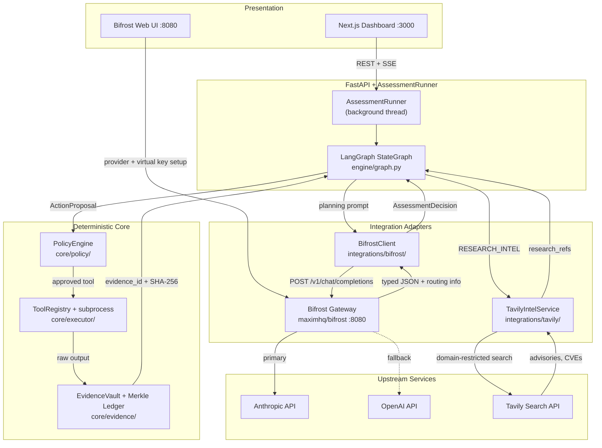
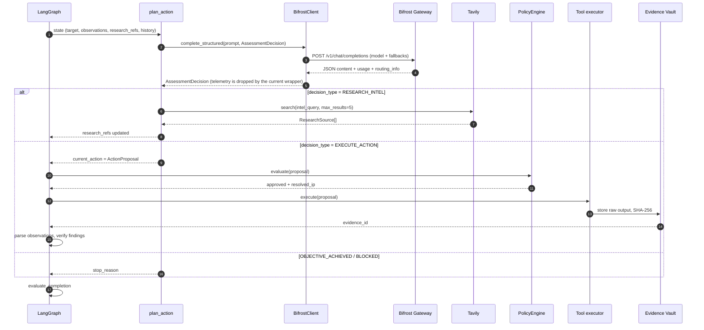

# Bifrost + Tavily: Provider Wiring and the Agent Loop

> **Who this is for:** you have added Bifrost and Tavily credentials, but you want to understand exactly how ARGUS connects providers, selects a model, and uses both services inside the LangGraph assessment loop.
>
> **Short version:** Bifrost is the only path to an LLM. Tavily is a search API, not a model provider. The loop is deterministic except for one decision point per iteration: `plan_action`, where the LLM chooses between running a tool, doing Tavily research, or stopping.

---

## 0. Do this first (checklist)

If you only want the shortest path to a working live model:

1. Start Bifrost (`docker compose -f compose.dev.yaml up --build`, or the standalone `docker run` in §3.1).
2. Open <http://localhost:8080> and add **Anthropic** and **OpenAI** under **Model Providers**, using `env.ANTHROPIC_API_KEY` / `env.OPENAI_API_KEY` or pasted keys.
3. Create a **virtual key** for ARGUS and put it in `ARGUS_BIFROST_API_KEY`.
4. In `.env`, set:
   - `ARGUS_BIFROST_BASE_URL=http://localhost:8080/v1`
   - `ARGUS_BIFROST_PRIMARY_MODEL=anthropic/claude-3-5-sonnet-20241022` (use the exact ID Bifrost shows)
   - `ARGUS_BIFROST_FALLBACK_MODEL=openai/gpt-4o`
   - `ARGUS_TAVILY_API_KEY=tvly-...`
   - `ARGUS_SIMULATION_MODE=false`
5. Verify with `curl http://localhost:8080/v1/models -H "Authorization: Bearer $ARGUS_BIFROST_API_KEY"`.
6. Launch an assessment and watch requests appear in the Bifrost UI.

> **Critical:** model IDs must be `provider/model` for reliable Bifrost routing. ARGUS now sends that form by default and forwards the fallback as a `fallbacks` array in the request body. If you override the model values, keep the provider prefix. See §4.4–§4.5.

---

## 1. The mental model

There are three different things in this integration, and mixing them up is the usual source of confusion:

| Component | What it is | What it is **not** |
|---|---|---|
| **Bifrost** (`maximhq/bifrost`) | A self-hosted, OpenAI-compatible **LLM gateway**. It holds provider API keys, exposes one `/v1/chat/completions` endpoint, routes to Anthropic/OpenAI/etc., and can fail over between them. | It is not a model. It does not reason. It does not know what a vulnerability is. |
| **Tavily** (`api.tavily.com`) | A **web search API** tuned for research. ARGUS uses it to retrieve advisories and CVE pages. | It is not an LLM, and it does not choose tools or execute scans. |
| **LangGraph orchestrator** (`engine/graph.py`) | The **agent loop**. It owns state, runs deterministic safety/tool/evidence nodes, and calls the LLM exactly once per planning iteration. | It is not a model gateway. It does not call Anthropic or OpenAI directly. |

So the dependency direction is:

```text
LangGraph ──> BifrostClient ──> Bifrost Gateway ──> Anthropic / OpenAI / ...
    │
    └──> TavilyIntelService ──> Tavily Search API
```

The LLM never talks to Tavily directly. The LLM asks for research by returning `decision_type: "RESEARCH_INTEL"`; the orchestrator performs the Tavily call and feeds the results into the next prompt.

---

## 2. End-to-end architecture



Two important consequences:

1. **There is only one LLM call site.** Every model decision in the loop goes through `BifrostClient.complete_structured()`, called from `plan_action_node`.
2. **Everything after the LLM is deterministic.** Policy approval, tool execution, evidence hashing, finding promotion, completion evaluation, and report generation are code, not model output. That is what makes the agent auditable.

---

## 3. Connecting providers to Bifrost

Bifrost needs two separate things before ARGUS can use it:

1. **Upstream provider credentials** — Anthropic and/or OpenAI API keys, registered inside Bifrost.
2. **A Bifrost credential for ARGUS** — a virtual key (or Basic Auth admin credentials) that ARGUS sends on every request.

These are not the same key, and the setup token is a third thing.

### 3.1 Start the gateway

With the repo's Docker Compose stack:

```bash
docker compose -f compose.dev.yaml up --build
```

Or standalone:

```bash
docker run -d --name argus-bifrost -p 8080:8080 \
  -v "$(pwd)/bifrost-data:/app/data" \
  -e ANTHROPIC_API_KEY="$ANTHROPIC_API_KEY" \
  -e OPENAI_API_KEY="$OPENAI_API_KEY" \
  -e BIFROST_SETUP_TOKEN="argus-admin-token-2026" \
  maximhq/bifrost:latest
```

`BIFROST_SETUP_TOKEN` only unlocks the first-time admin setup in the web UI. It is **not** the key ARGUS uses for inference.

### 3.2 Register providers

The reliable path is the Bifrost UI:

1. Open <http://localhost:8080>.
2. Enter the setup token if prompted (`argus-admin-token-2026` by default).
3. Go to **Model Providers** → select **Anthropic** → add a key.
   - Key value: `env.ANTHROPIC_API_KEY` (references the container environment), or paste the key directly.
   - Models: `*` (or restrict to specific models).
4. Repeat for **OpenAI** with `env.OPENAI_API_KEY`.
5. Save, then confirm the provider shows as healthy.

The same thing through Bifrost's API:

```bash
curl -X POST http://localhost:8080/api/providers \
  -H 'Content-Type: application/json' \
  -d '{
    "provider": "anthropic",
    "keys": [{
      "name": "anthropic-key-1",
      "value": "env.ANTHROPIC_API_KEY",
      "models": ["*"],
      "weight": 1.0
    }]
  }'

curl -X POST http://localhost:8080/api/providers \
  -H 'Content-Type: application/json' \
  -d '{
    "provider": "openai",
    "keys": [{
      "name": "openai-key-1",
      "value": "env.OPENAI_API_KEY",
      "models": ["*"],
      "weight": 1.0
    }]
  }'
```

Or through `config.json` if you deploy Bifrost as code:

```json
{
  "providers": {
    "anthropic": {
      "keys": [
        { "name": "anthropic-key-1", "value": "env.ANTHROPIC_API_KEY", "models": ["*"], "weight": 1.0 }
      ]
    },
    "openai": {
      "keys": [
        { "name": "openai-key-1", "value": "env.OPENAI_API_KEY", "models": ["*"], "weight": 1.0 }
      ]
    }
  }
}
```

> **Note:** forwarding `ANTHROPIC_API_KEY` / `OPENAI_API_KEY` into the container is necessary but not sufficient on its own. The provider entry has to exist in Bifrost and reference that environment variable (or hold the key directly). Creating the provider in the UI is the simplest way to guarantee that.

### 3.3 Model IDs are `provider/model`

Bifrost's documented request contract uses a **provider-prefixed model ID**:

```text
anthropic/claude-3-5-sonnet-20241022
openai/gpt-4o
```

The prefix is what tells Bifrost which provider to route to. A bare model name may work in some builds through a model catalog, but `provider/model` is the portable form and the one the Bifrost docs use.

This matters because ARGUS's `.env.example` currently shows bare names:

```bash
ARGUS_BIFROST_PRIMARY_MODEL=claude-3-5-sonnet-20241022
ARGUS_BIFROST_FALLBACK_MODEL=gpt-4o
```

For a real Bifrost instance, prefer:

```bash
ARGUS_BIFROST_PRIMARY_MODEL=anthropic/claude-3-5-sonnet-20241022
ARGUS_BIFROST_FALLBACK_MODEL=openai/gpt-4o
```

Use the exact IDs shown in your Bifrost provider/model list. Model IDs are retired over time, so verify them in the UI rather than assuming an old ID still exists.

### 3.4 Create a virtual key for ARGUS

ARGUS authenticates with `ARGUS_BIFROST_API_KEY`. In `Bifrost`:

1. Go to **Governance** → **Virtual Keys** (or the equivalent section in your Bifrost version).
2. Create a key, for example `argus-agent`.
3. Allow the providers/models ARGUS should use (`anthropic`, `openai`).
4. Copy the generated key into `.env`:

```bash
ARGUS_BIFROST_API_KEY=sk-bf-...
```

The repo's `sk-bf-local` placeholder only works if your Bifrost instance accepts it. If inference auth is enforced, a placeholder will return `401`/`403`; create a real virtual key.

If you use Basic Auth instead of a virtual key:

```bash
BIFROST_ADMIN_USERNAME=admin
BIFROST_ADMIN_PASSWORD=...
ARGUS_BIFROST_API_KEY=
```

`BifrostClient.get_auth_header()` base64-encodes these into `Authorization: Basic ...`.

> **Caveat:** the assessment creation endpoint currently checks only `settings.BIFROST_API_KEY` before allowing a live run (`apps/api/routers/assessments.py`, `create_assessment`). If you configure only admin credentials, the API can reject the run with `503` even though the orchestrator itself would accept Basic Auth. Set a non-empty `ARGUS_BIFROST_API_KEY`, or adjust that guard.

### 3.5 Pick the right base URL

| Where ARGUS runs | `ARGUS_BIFROST_BASE_URL` |
|---|---|
| Local Python process | `http://localhost:8080/v1` |
| Inside Docker Compose (`argus-api` container) | `http://bifrost:8080/v1` |
| Remote/self-hosted Bifrost | `https://your-bifrost-host/v1` |

In Compose, `compose.base.yaml` already defaults the API container to `http://bifrost:8080/v1` through `ARGUS_DOCKER_BIFROST_BASE_URL`.

### 3.6 Connect Tavily

Tavily is simpler: it only needs one key.

```bash
ARGUS_TAVILY_API_KEY=tvly-...
ARGUS_ENABLE_TAVILY_RESEARCH=true
```

Get a key at <https://app.tavily.com>. The client calls `POST https://api.tavily.com/search` with `search_depth: "advanced"` and a fixed allow-list of authoritative domains:

```python
AUTHORITATIVE_DOMAINS = [
    "nvd.nist.gov",
    "cve.mitre.org",
    "exploit-db.com",
    "github.com",
    "apache.org",
]
```

There is no provider/model selection for Tavily. It returns `ResearchSource` records; it never returns an action or a model decision.

---

## 4. How a model is selected

Model selection happens at four distinct layers. Only one of them is controlled by the LLM itself.

| Layer | Question | Decided by | Where |
|---|---|---|---|
| **1. Gateway selection** | Do we use Bifrost, a mock, or fail closed? | Deterministic startup logic | `AssessmentOrchestrator.__init__` (`engine/graph.py`) |
| **2. Request model** | Which model do we ask for on this call? | `BIFROST_PRIMARY_MODEL` | `BifrostClient.complete_structured` |
| **3. Provider routing / fallback** | Which upstream actually serves it? | Bifrost config + request body | Bifrost gateway |
| **4. Failure handling** | What if all providers fail? | Deterministic ARGUS recovery | `plan_action_node`, `engine/recovery.py` |

### 4.1 Layer 1 — gateway selection

At orchestrator construction:

```python
if model_gateway is not None:          # dependency injection (tests / custom gateway)
    self.model_gateway = model_gateway
elif settings.BIFROST_API_KEY or (admin_username and admin_password):
    self.model_gateway = create_bifrost_model_gateway(BifrostClient(...))
elif self.simulation_mode:
    self.model_gateway = self._default_mock_model_gateway
else:
    self.model_gateway = self._fail_closed_model_gateway
```

This is deliberately fail-closed. If no gateway is configured and simulation is off, the planner returns `BLOCKED` rather than inventing a decision. There is no silent fallback to a mock in a live assessment.

### 4.2 Layer 2 — the request model

`BifrostClient.complete_structured()` always sends the same model for every call:

```python
payload = {
    "model": self.primary_model,
    "messages": messages,
    "response_format": {"type": "json_object"},
    "temperature": 0.1,
}
```

There is **no per-node model selection** today. Recon planning, exploit planning, and completion decisions all use `BIFROST_PRIMARY_MODEL`. There is also no separate "verifier LLM": finding verification is deterministic code (`verify_finding_node` + evidence integrity + Merkle proof), not a second model.

### 4.3 Layer 3 — provider routing and fallback

Bifrost can do more than forward one model. Its documented mechanism for fallback is a `fallbacks` array in the **request body**, using `provider/model` strings:

```json
{
  "model": "anthropic/claude-3-5-sonnet-20241022",
  "fallbacks": ["openai/gpt-4o"],
  "messages": [{"role": "user", "content": "..."}]
}
```

Bifrost tries the primary, then each fallback in order. The response includes routing information:

```json
{
  "extra_fields": {
    "routing_info": {
      "provider": "openai",
      "model": "gpt-4o",
      "is_fallback": true,
      "primary_provider": "anthropic",
      "primary_model": "claude-3-5-sonnet-20241022"
    }
  }
}
```

That is how you can tell whether a fallback actually happened.

### 4.4 What ARGUS sends now

The client sends the provider-prefixed model and a `fallbacks` array:

```python
headers = {
    "Authorization": auth_header,
    "Content-Type": "application/json",
}

payload = {
    "model": self.primary_model,          # e.g. anthropic/claude-3-5-sonnet-20241022
    "messages": messages,
    "response_format": {"type": "json_object"},
    "temperature": 0.1,
}
if self.fallback_model and self.fallback_model != self.primary_model:
    payload["fallbacks"] = [self.fallback_model]  # e.g. ["openai/gpt-4o"]
```

The client no longer relies on the undocumented `X-Bifrost-Fallback` header. It reads routing metadata from the response body first, then falls back to legacy headers only if they are present:

```python
routing = data.get("extra_fields", {}).get("routing_info", {})
provider = routing.get("provider") or resp.headers.get("X-Bifrost-Provider") or "unknown"
fallback = bool(routing.get("is_fallback", False))
model_used = data.get("model") or routing.get("model") or self.primary_model
```

This makes `BifrostTelemetry.provider_used`, `.model_used`, and `.fallback_triggered` reflect what actually served the request.

### 4.5 Telemetry propagation

`BifrostModelGateway` is a callable object rather than a bare function. It stores the `BifrostTelemetry` returned by each completion in `last_telemetry`; `plan_action_node` reads that attribute after every successful model call and appends the serialized event to `state["telemetry"]`.

That means the report's "Bifrost Telemetry" section now has data, and the API's `telemetry` field is populated for the dashboard. Telemetry is appended once per planning call, including calls that result in `RESEARCH_INTEL`, duplicate rejection, or completion.

One flag is still informational only: `ENABLE_PROVIDER_FALLBACK` exists in `core/config.py` but is not consulted when building the request. The client always includes the configured fallback chain. If you want an operational kill switch for fallback, that flag still needs to be wired into `BifrostClient.complete_structured()`.

### 4.6 If you want different models per task

Today: one model for every planning call.

If you want, for example, a cheap model for routine recon planning and a stronger model for exploit chaining, you have two options:

1. **Bifrost-side routing** — use virtual keys, routing rules, or weighted provider selection to control which upstream serves a given model ID. This changes *where* a request goes, not *which model ARGUS asks for*.
2. **ARGUS-side model profiles** — add a model parameter to `complete_structured()` and choose it per node (or per strategy) in `plan_action_node`. This is a real code change; the current contract has a single `primary_model`.

For the current architecture, the second option is the only way to get true per-node model selection.

---

## 5. Inside the loop, node by node

The compiled graph (`engine/graph.py`, `_build_graph`) is:

```text
START
  └─> validate_scope
        ├─ FAILED ─> report ─> END
        └─ ok ─> recon
                  └─> normalize_observations
                        └─> plan_action
                              ├─ action proposed ─> policy_gate
                              │                       ├─ approved ─> execute_tool
                              │                       │               ├─ success ─> verify_finding
                              │                       │               └─ failure ─> adaptive_recovery
                              │                       └─ denied ─> evaluate_completion
                              └─ no action ─> evaluate_completion
                                                ├─ not complete ─> plan_action (loop)
                                                └─ complete ─> report ─> END
```

| Node | LLM call? | Tavily call? | What it does |
|---|---:|---:|---|
| `validate_scope` | No | No | Validates the scope document's schema and temporal validity. |
| `recon` | No | No | Runs the registered `network_recon` tool (Nmap by default), stores raw output in the Evidence Vault, parses observations, discovers assets/services. |
| `normalize_observations` | No | No | Adjusts `current_strategy` based on what was discovered. |
| `plan_action` | **Yes — the only one** | **Yes, if the model asks** | Builds the prompt, calls Bifrost, interprets the `AssessmentDecision`. |
| `policy_gate` | No | No | Deterministic `PolicyEngine.evaluate()`; resolves and pins the target IP. |
| `execute_tool` | No | No | Runs the approved tool via subprocess, rate-limits it, enforces timeout, stores evidence, parses observations. |
| `adaptive_recovery` | No | No | Classifies the failure and applies bounded backoff/retry policy. |
| `verify_finding` | No | No | Promotes `vuln_candidate` observations to findings only when evidence integrity and ledger attestation checks pass. |
| `evaluate_completion` | No | No | Deterministic check of objective, budget, cancellation, recovery limits, and verified evidence. |
| `report` | No | No | Renders Markdown/PDF and writes them to the assessment artifact directory. |

### 5.1 One iteration in sequence



### 5.2 What `plan_action` actually sends

`engine/prompts.py` builds a prompt containing:

- target and objective,
- the registered tool descriptors (name, category, arguments),
- discovered assets and services,
- the last 10 observations,
- **all** `research_refs` (Tavily results),
- current findings,
- the last 10 executed action fingerprints,
- the last 5 blocked proposals,
- the current strategy.

The system prompt tells the model to return JSON matching `AssessmentDecision` and defines the allowed decision types. The decision contract is in `packages/contracts/actions.py`:

```python
class DecisionType(str, Enum):
    EXECUTE_ACTION = "EXECUTE_ACTION"
    RESEARCH_INTEL = "RESEARCH_INTEL"
    OBJECTIVE_ACHIEVED = "OBJECTIVE_ACHIEVED"
    BLOCKED = "BLOCKED"
    NEEDS_CLARIFICATION = "NEEDS_CLARIFICATION"
```

`AssessmentDecision` also carries `rationale`, an optional `ActionProposal`, an optional `intel_query`, and an optional `completion_summary`.

### 5.3 What happens for each decision type

| Decision | Orchestrator behavior | Next node |
|---|---|---|
| `EXECUTE_ACTION` + `proposed_action` | Fingerprints the action. If the fingerprint already exists in `action_history`, the action is added to `blocked_actions` and the strategy pivots to `CVE_VERIFICATION`. Otherwise it becomes `current_action`. | `policy_gate` |
| `RESEARCH_INTEL` + `intel_query` | Calls Tavily (if configured and enabled), appends results to `research_refs`, sets strategy to `CVE_VERIFICATION`. | `evaluate_completion` → `plan_action` |
| `OBJECTIVE_ACHIEVED` | Sets `stop_reason` from `completion_summary` or `rationale`. | `evaluate_completion` → `report` |
| `BLOCKED` | Sets `stop_reason`; the assessment stops without executing anything further. | `evaluate_completion` → `report` |
| `NEEDS_CLARIFICATION` | No special branch; it falls through to `evaluate_completion` and the loop continues. | `evaluate_completion` |

A malformed response (invalid JSON or schema mismatch) raises `BifrostValidationError` in the client. `plan_action_node` catches any exception from the gateway and fails closed: status `FAILED`, a safe stop reason, and state preserved. It does **not** fabricate a decision.

### 5.4 The Tavily path in detail

Tavily is **LLM-triggered**, not automatic. The current code path is:

```python
# Simplified: the real code wraps the async call in asyncio.run() or a thread pool.
if decision.decision_type == DecisionType.RESEARCH_INTEL:
    query = decision.intel_query or "service vulnerability"
    ...
    if self.tavily_service and settings.ENABLE_TAVILY_RESEARCH:
        sources = asyncio.run(self.tavily_service.search(query=query, max_results=5))
        new_research.extend(src.model_dump() for src in sources)
```

This means:

- During `recon`, ARGUS does **not** automatically query Tavily just because it found a service.
- The LLM must decide that it needs research and return `RESEARCH_INTEL` with a query such as `"Apache 2.4.49 path traversal CVE"`.
- The system prompt explicitly instructs it to do this for "unindexed software versions."
- On the next loop iteration, those results are injected into the prompt under `### THREAT INTELLIGENCE (Tavily Advisories)`.
- Confirmed findings can cite those URLs in the report's "External Intelligence (Tavily)" section.

Two guardrails matter:

1. **Tavily never confirms a finding.** Its output is external intelligence. Only `verify_finding_node`, using verified evidence, can promote a finding to `CONFIRMED`.
2. **Tavily failures are non-fatal.** `TavilyIntelService.search()` returns `[]` on HTTP errors, timeouts, or a missing key, so the assessment continues.

One behavior to be aware of: if no research was retrieved, `plan_action_node` appends a placeholder record:

```python
{"query": query, "advisory": f"Security advisory for {query}", "source": "Tavily"}
```

That keeps the loop moving but can make it look as if Tavily returned something when it did not. If you want strict provenance, remove this placeholder or label it explicitly as `UNVERIFIED_PLACEHOLDER`.

### 5.5 Safety and budget controls around the loop

The LLM is intentionally boxed in:

| Control | Effect |
|---|---|
| **Policy gate** | Every proposed action is re-validated against scope, ports, and forbidden argument tokens before execution. Denied actions never reach the network. |
| **Duplicate fingerprinting** | `ActionProposal.fingerprint()` prevents the same tool/target/arguments combination from running twice. |
| **Iteration budget** | `iterations_used` and `model_calls_used` are incremented in `plan_action_node`; `max_iterations` defaults to 20. |
| **Duration budget** | `max_duration_seconds` defaults to 1800. |
| **Rate limiter** | Tool execution is bounded by `scope.rate_limits` and `ToolRateLimiter`. |
| **Evidence integrity** | Findings are promoted only if the evidence artifact still hashes correctly and, when the proof ledger is enabled, has a T2 inclusion proof. |
| **Fail-closed gateway** | If Bifrost is unreachable or returns invalid JSON, the assessment stops safely instead of inventing a next action. |

---

## 6. A worked iteration

A typical loop for a target exposing `Apache/2.4.49`:

1. **`recon`** runs Nmap, stores the raw output, and records observations such as `service_version: Apache 2.4.49` on port 80.
2. **`normalize_observations`** sets `current_strategy` to `SERVICE_ENUMERATION`.
3. **`plan_action`** builds a prompt containing the discovered service. The model returns:

   ```json
   {
     "decision_type": "RESEARCH_INTEL",
     "rationale": "Apache 2.4.49 is a known-vulnerable version; retrieve authoritative advisories before probing.",
     "intel_query": "Apache 2.4.49 path traversal CVE advisory"
   }
   ```

4. The orchestrator calls Tavily, appends `ResearchSource` records to `research_refs`, and sets strategy to `CVE_VERIFICATION`.
5. **`evaluate_completion`** sees the objective is not met and loops back to **`plan_action`**.
6. The new prompt includes the Tavily advisories. The model returns an `EXECUTE_ACTION` proposal, for example a Nuclei template or a safe HTTP probe targeting the discovered path.
7. **`policy_gate`** approves it and pins the resolved IP.
8. **`execute_tool`** runs the tool, stores the raw output in the Evidence Vault, and parses observations.
9. **`verify_finding`** promotes any `vuln_candidate` observation to `CONFIRMED` only if the evidence hash and ledger proof check out.
10. **`evaluate_completion`** decides whether the objective is satisfied, the budget is exhausted, or another iteration is needed.
11. **`report`** writes Markdown/PDF, including findings, evidence references, Tavily citations, chain-of-custody, and (if wired) Bifrost telemetry.

This is the "Think → Gate → Act → Observe → Verify → Evaluate" loop, with exactly one model call per Think step.

---

## 7. Implementation status and remaining gaps

The model-routing, fallback, and telemetry issues identified earlier are now fixed:

| Previously broken | Current behavior |
|---|---|
| Bare model IDs | `core/config.py`, `.env.example`, and `compose.base.yaml` default to provider-prefixed IDs; `BifrostClient` also defaults to them. |
| Fallback via `X-Bifrost-Fallback` header | `BifrostClient` sends `payload["fallbacks"] = [fallback_model]`. |
| Fallback telemetry from undocumented headers | `BifrostClient` reads `extra_fields.routing_info` first, then legacy headers. |
| Telemetry discarded by the wrapper | `BifrostModelGateway.last_telemetry` is read by `plan_action_node` and appended to `state["telemetry"]`. |

These are still open and are worth knowing when debugging:

| Gap | Where | Effect | Suggested fix |
|---|---|---|---|
| `ENABLE_PROVIDER_FALLBACK` is unused | `core/config.py` | Toggling it does not change request behavior; fallback is always sent | Consult it when building the request payload |
| Live-run guard checks only `BIFROST_API_KEY` | `apps/api/routers/assessments.py` | Admin-only Basic Auth config can be rejected with `503` | Also accept admin credentials in the guard |
| Tavily is not automatic on recon | `engine/graph.py` | Services are discovered but no research happens unless the LLM chooses `RESEARCH_INTEL` | Keep LLM-driven, or add an explicit recon research step |
| Placeholder research record | `plan_action_node` | Can imply Tavily returned data when it did not | Remove it or label it `UNVERIFIED_PLACEHOLDER` |
| Static domain allow-list | `integrations/tavily/tavily_client.py` | Vendor advisories outside the list are filtered out | Add domains or make the list configurable |

---

## 8. Configuration recipes

### 8.1 Local process (Bifrost in Docker, API on host)

```bash
# Bifrost
BIFROST_SETUP_TOKEN=argus-admin-token-2026
ANTHROPIC_API_KEY=sk-ant-...
OPENAI_API_KEY=sk-proj-...

# ARGUS → Bifrost
ARGUS_BIFROST_BASE_URL=http://localhost:8080/v1
ARGUS_BIFROST_API_KEY=sk-bf-...          # real virtual key, or sk-bf-local if auth is open
ARGUS_BIFROST_PRIMARY_MODEL=anthropic/claude-3-5-sonnet-20241022
ARGUS_BIFROST_FALLBACK_MODEL=openai/gpt-4o

# Tavily
ARGUS_TAVILY_API_KEY=tvly-...
ARGUS_ENABLE_TAVILY_RESEARCH=true

# Mode
ARGUS_SIMULATION_MODE=false
```

### 8.2 Full Docker Compose

Use the same values, but set:

```bash
ARGUS_BIFROST_BASE_URL=http://bifrost:8080/v1
```

`compose.base.yaml` forwards `ANTHROPIC_API_KEY`, `OPENAI_API_KEY`, `GEMINI_API_KEY`, and `GROQ_API_KEY` into the `bifrost` container, and forwards `ARGUS_BIFROST_API_KEY`, `ARGUS_TAVILY_API_KEY`, and the model/base-url settings into `argus-api`.

### 8.3 Offline/simulation mode

```bash
ARGUS_SIMULATION_MODE=true
ARGUS_BIFROST_API_KEY=
```

In this mode, the orchestrator uses `_default_mock_model_gateway` and simulated tool output. This is explicitly labeled in the report and must not be used for a live assessment.

### 8.4 Live mode with no gateway

```bash
ARGUS_SIMULATION_MODE=false
ARGUS_BIFROST_API_KEY=
```

The orchestrator uses `_fail_closed_model_gateway`, which returns `BLOCKED`. The API also rejects assessment creation with `503` in this configuration. This is intentional: no fabricated planner decisions.

---

## 9. Verification

### 9.1 Bifrost is up and knows your models

```bash
curl -s http://localhost:8080/v1/models \
  -H "Authorization: Bearer $ARGUS_BIFROST_API_KEY" | jq
```

You should see the provider-prefixed model IDs, for example `anthropic/claude-3-5-sonnet-20241022` and `openai/gpt-4o`.

### 9.2 A direct completion with fallback

```bash
curl -s -X POST http://localhost:8080/v1/chat/completions \
  -H "Content-Type: application/json" \
  -H "Authorization: Bearer $ARGUS_BIFROST_API_KEY" \
  -d '{
    "model": "anthropic/claude-3-5-sonnet-20241022",
    "fallbacks": ["openai/gpt-4o"],
    "messages": [{"role": "user", "content": "Reply with the single word: ok"}]
  }' | jq '{model, usage, routing: .extra_fields.routing_info}'
```

If `routing.provider` is `openai` and `routing.is_fallback` is `true`, fallback worked.

### 9.3 ARGUS integration tests

```bash
pytest tests/integration/test_bifrost_client.py -v
pytest tests/integration/test_tavily_client.py -v
pytest tests/integration/test_scenarios.py -v
```

These use mock HTTP transports, so they verify ARGUS's request/response handling, not your live provider keys.

### 9.4 End-to-end check

1. Start the stack.
2. Open the dashboard at <http://localhost:3000>.
3. Launch an assessment against the mock lab (`http://localhost:8888`).
4. Keep the Bifrost UI open at <http://localhost:8080>. You should see each planning request, its model, latency, and token usage.
5. Check the assessment report for the Bifrost telemetry section and Tavily citations.

---

## 10. Troubleshooting

| Symptom | Likely cause | Fix |
|---|---|---|
| `401` / `403` from Bifrost | Placeholder `sk-bf-local` used while inference auth is enforced; wrong virtual key; setup token confused with API key | Create a virtual key in Bifrost and set `ARGUS_BIFROST_API_KEY` |
| `404 model not found` | Missing `provider/model` prefix; provider not registered; model ID retired | Use the exact ID from Bifrost's model list; register the provider |
| `400`/`403` model not allowed | Virtual key restricts providers/models | Allow the model on the virtual key, or use a broader key |
| Connection refused | Wrong base URL (`localhost` from inside a container) | Use `http://bifrost:8080/v1` inside Compose |
| `BifrostValidationError` | Model returned prose or malformed JSON; JSON mode unsupported | Keep `temperature` low, ensure `response_format` is accepted, tighten the system prompt/schema |
| Fallback never triggers | Using `X-Bifrost-Fallback` header instead of `fallbacks` body array | Add `fallbacks` to the request payload |
| Telemetry section says none captured | `create_bifrost_model_gateway()` drops the telemetry object | Forward telemetry into state (see §7) |
| Assessment rejected with `503` | `ARGUS_BIFROST_API_KEY` empty and simulation off | Set the key, or explicitly enable simulation |
| Tavily returns nothing | Missing/invalid key, query too broad, or all results filtered by the domain allow-list | Check the key, query a specific product/version, add relevant domains |
| Loop stops immediately | Model returned `OBJECTIVE_ACHIEVED` or `BLOCKED`; gateway exception; budget exhausted | Inspect `stop_reason`, Bifrost logs, and `budget` in the assessment state |

---

## 11. File map

| Concern | File |
|---|---|
| Bifrost HTTP client, auth, JSON validation, telemetry extraction | `integrations/bifrost/bifrost_client.py` |
| Bifrost telemetry model | `integrations/bifrost/telemetry.py` |
| Tavily client, domain allow-list, `ResearchSource` | `integrations/tavily/tavily_client.py` |
| Graph nodes, conditional edges, gateway selection | `engine/graph.py` |
| Planning prompt and system prompt | `engine/prompts.py` |
| Assessment state schema | `engine/state.py` |
| Decision/action contracts | `packages/contracts/actions.py` |
| Provider/model/Tavily settings | `core/config.py` |
| Background runner and SSE event publication | `apps/api/runner.py` |
| Live-run guard and assessment API | `apps/api/routers/assessments.py` |
| Bifrost + Tavily container wiring | `compose.base.yaml` |
| Existing operations guide | `docs/BIFROST_AND_TAVILY_GUIDE.md` |

---

## 12. Summary

- **Bifrost** is the single LLM gateway. Register Anthropic/OpenAI inside it, create a virtual key for ARGUS, and point `ARGUS_BIFROST_BASE_URL` at `/v1`.
- **Tavily** is a search API. It is called only when the model returns `RESEARCH_INTEL`, and its output is advisory, never confirming.
- **Model selection** is: gateway selection at startup → `BIFROST_PRIMARY_MODEL` per request → Bifrost routing/fallback → ARGUS fail-closed recovery.
- **The loop** calls the LLM once per iteration in `plan_action`; every other node is deterministic and evidence-producing.
- **The request contract is now aligned with Bifrost:** provider-prefixed model IDs, `fallbacks` in the body, routing telemetry parsed from `extra_fields.routing_info`, and telemetry persisted into `state["telemetry"]`. If you override the model values, keep the `provider/` prefix.
