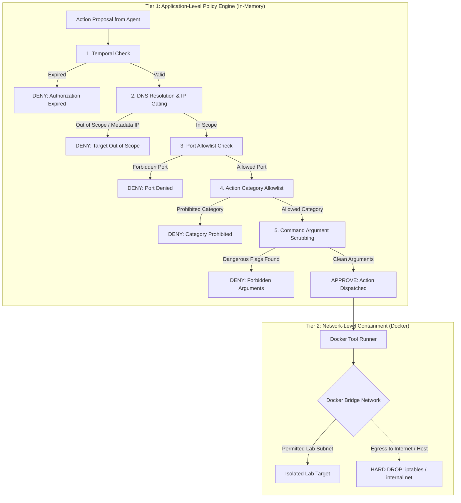

# Module 01 — Scope & Safety Policy Engine

**Module ID:** `core-scope`  
**Status:** Approved Specification  
**Primary Owner:** Dev 1  
**Dependencies:** None  
**Downstream Consumers:** `tool-engine`, `agent-orchestrator`, `api-lifecycle`  

---

## 1. Overview & Architectural Role

The **Scope & Safety Policy Engine** is the release-blocking safety foundation of ARGUS. It guarantees that **zero out-of-scope actions** occur during an assessment.

Under Challenge 03 rules, an out-of-scope tool execution results in immediate disqualification. Therefore:
1. The LLM is **never** trusted to determine whether an action is safe or in-scope.
2. Every action proposal must pass a deterministic Python policy check before command execution.
3. Network-level Docker egress controls provide a secondary physical barrier.

---

## 2. Scope Document Specification

The scope document is a versioned YAML document supplied at assessment creation.

### 2.1 Complete YAML Schema
```yaml
schema_version: "1.0"
assessment_id: "asm-20261104-001"
name: "Authorized Hackathon Target Evaluation"
created_at: "2026-11-04T12:00:00Z"
expires_at: "2026-11-05T12:00:00Z"

targets:
  allowed_hosts:
    - "192.168.100.5"
    - "lab-target.local"
  allowed_subnets:
    - "192.168.100.0/28"
  denied_hosts:
    - "192.168.100.1"          # Lab Gateway
    - "169.254.169.254"         # Cloud Metadata Instance Service
    - "127.0.0.1"              # Localhost
    - "localhost"

ports:
  allowed_ports: [80, 443, 8080, 8443, 22, 21]
  denied_ports: [25, 445, 139, 3389]

protocols:
  allowed: ["http", "https", "tcp"]
  denied: ["udp", "icmp", "dns-zone-transfer"]

actions:
  allowed_categories:
    - "network_recon"
    - "web_crawl"
    - "passive_vuln_scan"
    - "active_template_check"
  prohibited_categories:
    - "denial_of_service"
    - "brute_force_credentials"
    - "arbitrary_command_injection"
    - "lateral_movement"
    - "privilege_escalation"

rate_limits:
  max_requests_per_second: 20
  max_concurrency: 2
  tool_timeout_seconds: 180

network_policy:
  redirect_policy: "strict_same_host"  # "strict_same_host" | "in_scope_only" | "block_all"
  allow_external_dns: false
```

---

## 3. Two-Tier Enforcement Architecture



---

## 4. Deterministic Policy Implementation (`core/policy/policy_engine.py`)

> **Note:** The snippet below is illustrative pseudocode. The executable
> implementation in `core/policy/policy_engine.py` is the source of truth and
> includes a fail-closed wrapper, resolved-IP pinning, port-set expansion,
> protocol checks, redirect validation, and bounded chain authorization.

```python
import ipaddress
import socket
from datetime import datetime
from typing import NamedTuple, Optional
from core.scope.schema import ScopeDocument, ActionProposal


class PolicyDecision(NamedTuple):
    approved: bool
    reason: str
    resolved_ip: Optional[str] = None


class PolicyEngine:
    def __init__(self, scope: ScopeDocument):
        self.scope = scope
        self._parsed_subnets = [ipaddress.ip_network(s) for s in scope.targets.allowed_subnets]
        self._denied_ips = set(scope.targets.denied_hosts)

    def evaluate(self, proposal: ActionProposal) -> PolicyDecision:
        # 1. Temporal Check
        if datetime.utcnow() > self.scope.expires_at:
            return PolicyDecision(False, "Scope authorization expired.")

        # 2. Target Resolution & Subnet Check
        resolved_ip = self._resolve_host(proposal.target_host)
        if not resolved_ip:
            return PolicyDecision(False, f"Cannot resolve host '{proposal.target_host}'.")

        if resolved_ip in self._denied_ips:
            return PolicyDecision(False, f"Host IP {resolved_ip} is explicitly denied.")

        ip_obj = ipaddress.ip_address(resolved_ip)
        if ip_obj.is_loopback or ip_obj.is_link_local or ip_obj.is_reserved:
            return PolicyDecision(
                False, f"Target {resolved_ip} is a reserved/link-local address (SSRF guard)."
            )

        in_subnet = any(ip_obj in subnet for subnet in self._parsed_subnets)
        in_hosts = (
            proposal.target_host in self.scope.targets.allowed_hosts
            or resolved_ip in self.scope.targets.allowed_hosts
        )

        if not (in_subnet or in_hosts):
            return PolicyDecision(
                False, f"Target {proposal.target_host} ({resolved_ip}) is outside allowed targets."
            )

        # 3. Port Check
        if proposal.target_port is not None:
            if proposal.target_port in self.scope.ports.denied_ports:
                return PolicyDecision(False, f"Port {proposal.target_port} is explicitly denied.")
            if proposal.target_port not in self.scope.ports.allowed_ports:
                return PolicyDecision(
                    False, f"Port {proposal.target_port} is not in allowed ports."
                )

        # 4. Action Category Check
        if proposal.action_category in self.scope.actions.prohibited_categories:
            return PolicyDecision(
                False, f"Action category '{proposal.action_category}' is explicitly prohibited."
            )
        if proposal.action_category not in self.scope.actions.allowed_categories:
            return PolicyDecision(
                False, f"Action category '{proposal.action_category}' is not in allowed categories."
            )

        # 5. Argument Scrubbing (implementation signature: _verify_arguments(args))
        if not self._verify_arguments(proposal.arguments):
            return PolicyDecision(
                False, "Arguments contain forbidden flags or malformed shell tokens."
            )

        return PolicyDecision(True, "Action approved by policy engine.", resolved_ip=resolved_ip)

    def _resolve_host(self, host: str) -> Optional[str]:
        try:
            return socket.gethostbyname(host)
        except socket.error:
            return None

    def _verify_arguments(self, args: dict) -> bool:
        forbidden_tokens = [";", "&&", "||", "`", "$(", ">", "<", "|", "--exec", "--script=vuln"]
        for val in args.values():
            s_val = str(val)
            if any(token in s_val for token in forbidden_tokens):
                return False
        return True
```

---

## 5. Network-Level Docker Containment

In `infrastructure/docker-compose.yml`, the tool runner and lab target are joined to an isolated Docker bridge network:

```yaml
networks:
  argus-lab-net:
    driver: bridge
    ipam:
      config:
        - subnet: 192.168.100.0/24
    internal: true # Disables outbound routing to the public internet
```

- When `internal: true` is set, Docker blocks default gateway egress.
- Tool containers cannot reach host services (`localhost`) or external cloud metadata endpoints (`169.254.169.254`).

---

## 6. Acceptance Criteria & Test Scenarios

To consider `core-scope` complete, all 6 unit tests must pass:

1. `test_valid_scope_passes`: Legitimate target within `192.168.100.0/28` on port 8080 approved.
2. `test_expired_scope_fails`: Setting `expires_at` to yesterday returns `approved=False`.
3. `test_out_of_scope_ip_fails`: Proposing `10.0.0.1` returns `approved=False`.
4. `test_gateway_ip_fails`: Proposing `192.168.100.1` (denied host) returns `approved=False`.
5. `test_cloud_metadata_fails`: Proposing `169.254.169.254` returns `approved=False`.
6. `test_prohibited_action_fails`: Proposing `denial_of_service` returns `approved=False`.

