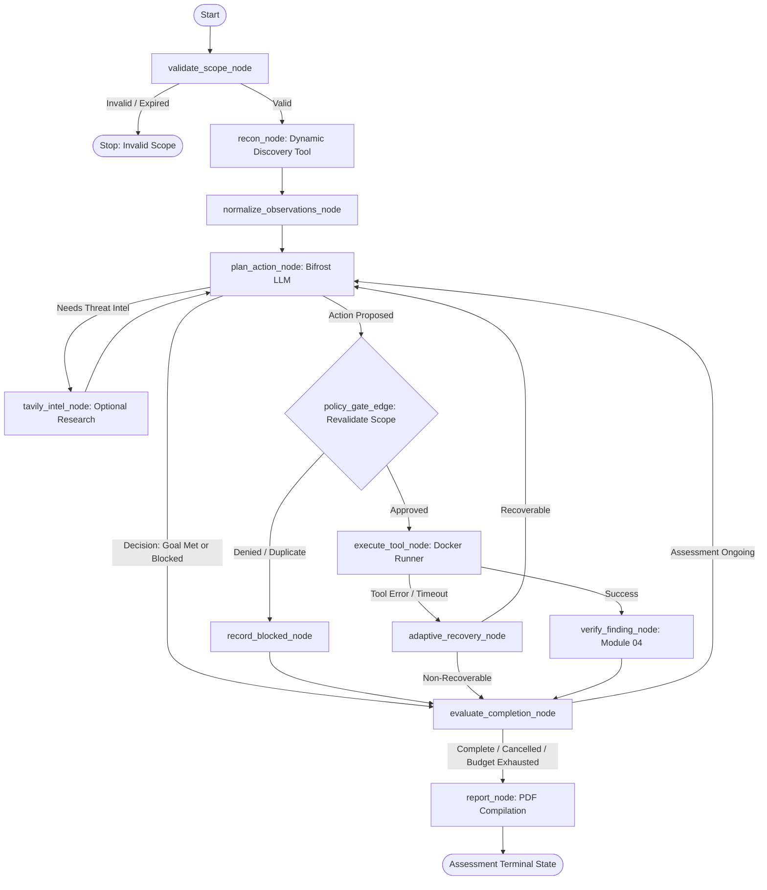

# Module 02 — Agent Orchestrator & Adaptive Recovery

**Module ID:** `agent-orchestrator`  
**Status:** Approved Specification (Reviewed & Enhanced)  
**Primary Owner:** Dev 1  
**Dependencies:** `core-scope` (Module 01), `tool-engine` (Module 03), `evidence-vault` (Module 04), `bifrost-gateway` (Module 05)  
**Downstream Consumers:** `api-lifecycle` (Module 06), `report-engine`  

---

## 1. Overview & Architectural Role

The **Agent Orchestrator** manages the autonomous security testing loop using a stateful **LangGraph** workflow. It replaces unpredictable multi-agent swarms with a single, stateful, deterministic-governed execution machine.

### Key Architectural Principles
1. **The LLM Proposes, Deterministic Logic Disposes:** The model never executes commands directly. It outputs typed action proposals and decisions that must pass deterministic policy gating and registry validation.
2. **Dynamic Tool Registry Integration:** Tools are discovered dynamically at runtime via Module 03's tool registry. The agent loop never hardcodes specific tool names or fixed call sequences.
3. **Adaptive, Context-Driven Planning:** The agent continuously synthesizes current observations, discovered topology, and previous test results, pivoting its investigation strategy when new ports or endpoints appear while preventing redundant actions.
4. **Separation of Execution and Assessment Decisions:** Tool execution proposals (`ActionProposal`) are decoupled from assessment-level conclusions (`AssessmentDecision`). The orchestrator deterministically verifies completion instead of trusting model claims.
5. **Bounded Resilience & Failure Taxonomy:** Classifies failures into recoverable, non-recoverable, and human-intervention-required, backing off with jitter on provider rate limits and terminating child processes safely on timeout or cancellation.

### Interfaces with Other Modules
- **Module 01 (`core-scope`):** Evaluates every proposed action immediately before execution against the immutable scope document.
- **Module 03 (`tool-engine`):** Queries available tools, capability tags, and parameter schemas; delegates containerized execution.
- **Module 04 (`evidence-vault`):** Stores raw tool output on disk, receives SHA-256 evidence IDs, and triggers finding verification checks.
- **Module 05 (`bifrost-gateway` & `tavily-intel`):** Consumes model completions with automated failover via Bifrost; requests optional, context-driven security intelligence from Tavily.
- **Module 06 (`api-lifecycle`):** Persists graph checkpoints in SQLite and emits real-time Server-Sent Events (SSE) for every state transition.

---

## 2. Complete State Schema (`engine/state.py`)

The state tracks assessment metadata, knowledge base, execution budget, and recovery health using typed models:

```python
from typing import TypedDict, List, Dict, Any, Optional
from pydantic import BaseModel, Field
from datetime import datetime


class ExecutionBudget(BaseModel):
    max_duration_seconds: int = 1800
    max_iterations: int = 20
    max_model_calls: int = 40
    iterations_used: int = 0
    model_calls_used: int = 0
    total_tokens_used: int = 0


class CancellationState(BaseModel):
    is_cancelled: bool = False
    cancelled_at: Optional[datetime] = None
    cancelled_by: Optional[str] = None
    reason: Optional[str] = None


class CompletionEvaluation(BaseModel):
    is_completed: bool = False
    outcome: str = (
        "IN_PROGRESS"  # SUCCESS | PARTIAL_SUCCESS | PAUSED | BLOCKED | FAILED | CANCELLED
    )
    satisfied_goals: List[str] = Field(default_factory=list)
    verification_evidence_ids: List[str] = Field(default_factory=list)
    summary: str = ""


class RecoveryState(BaseModel):
    consecutive_failures: int = 0
    max_consecutive_failures: int = 3
    active_backoff_seconds: float = 0.0
    last_failure_type: Optional[str] = None
    retry_counts_by_action: Dict[str, int] = Field(default_factory=dict)


class AssessmentState(TypedDict):
    # Assessment & Scope Identity
    assessment_id: str
    target: Dict[str, Any]  # {"type": "web" | "network", "value": "http://lab:8080"}
    assessment_objective: Dict[
        str, Any
    ]  # Target goals, e.g. {"find_cve": True, "required_hosts": 1}
    scope_id: str
    scope_version: str
    scope_snapshot_hash: str  # SHA-256 of active scope document to detect drift
    status: str  # DRAFT | VALIDATING | READY | RUNNING | PAUSED | COMPLETED | FAILED | CANCELLED

    # Dynamic Capability Context
    tool_registry_version: str
    available_tools: List[Dict[str, Any]]  # Discovered tool metadata from Module 03

    # Knowledge Base & Topology
    discovered_assets: List[str]  # ["192.168.100.5", "lab-target.local"]
    discovered_services: List[
        Dict[str, Any]
    ]  # [{"port": 8080, "service": "http", "version": "Apache 2.4.49"}]
    observations: List[Dict[str, Any]]  # Normalized observation structures
    research_refs: List[Dict[str, Any]]  # Tavily retrieved CVE intelligence & advisories

    # Planning & Audit History
    current_strategy: str  # e.g., "INITIAL_RECON", "SERVICE_ENUMERATION", "CVE_VERIFICATION"
    current_action: Optional[Dict[str, Any]]
    action_history: List[str]  # Canonical fingerprints of executed actions to prevent duplicates
    executed_actions: List[Dict[str, Any]]
    blocked_actions: List[Dict[str, Any]]

    # Findings & Integrity
    evidence_refs: List[Dict[str, Any]]  # List of {"evidence_id": "...", "sha256": "..."}
    findings: List[Dict[str, Any]]  # Verified & potential findings

    # Operational Controls & Budgets
    budget: Dict[str, Any]  # Serialized ExecutionBudget
    cancellation: Dict[str, Any]  # Serialized CancellationState
    recovery: Dict[str, Any]  # Serialized RecoveryState
    completion: Dict[str, Any]  # Serialized CompletionEvaluation
    started_at: str
    deadline_at: Optional[str]
    stop_reason: Optional[str]
```

---

## 3. LangGraph Workflow Graph



---

## 4. Action Proposals & Assessment Decisions

To cleanly separate tool execution from assessment lifecycle management, two distinct Pydantic models are enforced:

### 4.1 Tool Action Proposal (`packages/contracts/actions.py`)
Used **strictly** for requesting tool executions:

```python
from pydantic import BaseModel, ConfigDict, Field
from typing import Dict, Any, Optional


class ActionProposal(BaseModel):
    model_config = ConfigDict(frozen=True, extra="forbid")

    action_id: str = Field(..., description="Unique action tracking ID, e.g. act-003")
    target_host: str = Field(..., description="Target hostname or IP address")
    target_port: Optional[int] = Field(None, description="Target TCP/UDP port number")
    tool_name: str = Field(..., description="Registered tool name discovered from ToolRegistry")
    action_category: str = Field(
        ..., description="Action category (e.g. network_recon, web_crawl, active_template_check)"
    )
    arguments: Dict[str, Any] = Field(
        default_factory=dict, description="Tool-specific validated parameter map"
    )
    rationale: str = Field(
        ..., description="Why this action is needed based on previous observations"
    )
    expected_evidence: str = Field(
        ..., description="Expected output or indicator of success/failure"
    )
    timeout_seconds: int = Field(default=120, ge=5, le=600)

    def fingerprint(self) -> str:
        """Deterministic fingerprint to detect redundant or duplicate proposals."""
        import hashlib, json

        raw = f"{self.tool_name}:{self.target_host}:{self.target_port}:{json.dumps(self.arguments, sort_keys=True)}"
        return hashlib.sha256(raw.encode()).hexdigest()[:16]
```

### 4.2 Assessment Decision (`packages/contracts/actions.py`)
Used by the model to indicate high-level assessment intent:

```python
from enum import Enum


class DecisionType(str, Enum):
    EXECUTE_ACTION = "EXECUTE_ACTION"
    RESEARCH_INTEL = "RESEARCH_INTEL"
    OBJECTIVE_ACHIEVED = "OBJECTIVE_ACHIEVED"
    BLOCKED = "BLOCKED"
    NEEDS_CLARIFICATION = "NEEDS_CLARIFICATION"


class AssessmentDecision(BaseModel):
    model_config = ConfigDict(frozen=True, extra="forbid")

    decision_type: DecisionType
    rationale: str
    proposed_action: Optional[ActionProposal] = None
    intel_query: Optional[str] = None
    completion_summary: Optional[str] = None
```

---

## 5. Dynamic Tool Selection & Adaptive Planning

### 5.1 Dynamic Tool Registry Discovery
Instead of fixed calls to Nmap, ZAP, or Nuclei:
1. At assessment startup, `engine` queries `ToolRegistry.get_available_tools()` (Module 03).
2. The registry returns active tool descriptors:
   ```json
   [
     {
       "tool_name": "nmap",
       "categories": ["network_recon"],
       "capabilities": ["port_scan", "service_detection"],
       "risk_level": "LOW",
       "arg_schema": "NmapArgsSchema"
     },
     {
       "tool_name": "nuclei",
       "categories": ["active_template_check"],
       "capabilities": ["cve_verification"],
       "risk_level": "MEDIUM",
       "arg_schema": "NucleiArgsSchema"
     }
   ]
   ```
3. The LLM prompt is populated with whatever tools are currently registered. New tools can be introduced in Module 03 without modifying the LangGraph topology.

### 5.2 Adaptive Strategy Transitions
The agent selects its next move by evaluating:
- **Discovered Services:** When a new HTTP service (e.g. port 8080) is identified, the strategy pivots from `INITIAL_RECON` to `SERVICE_ENUMERATION` or `WEB_ANALYSIS`.
- **Duplicate Prevention:** Before dispatching an action, the engine computes `action.fingerprint()`. If the fingerprint exists in `action_history` with an identical outcome, the proposal is rejected as redundant, forcing the model to choose an alternative approach.
- **Context-Driven Threat Intel:** Tavily research is **optional**. It is triggered only when a specific software version is newly recognized and has not yet been researched, rather than running on every cycle.

---

## 6. Bounded Adaptive Recovery & Failure Taxonomy

Failures are categorized into three operational classes:

```
┌───────────────────────────────────────────────┐
│              FAILURE TAXONOMY                 │
├───────────────────────┬───────────────────────┤
│ RECOVERABLE           │ • Tool Timeout        │
│                       │ • Empty/Partial Output│
│                       │ • Provider Rate-Limit │
├───────────────────────┼───────────────────────┤
│ NON-RECOVERABLE       │ • Target Unreachable  │
│                       │ • Dependency Missing  │
│                       │ • Budget Exhausted    │
├───────────────────────┼───────────────────────┤
│ HUMAN INTERVENTION    │ • Scope Expired       │
│                       │ • Cancellation Active │
└───────────────────────┴───────────────────────┘
```

### Recovery Matrix & Mitigation Policies

| Failure Condition | Detection Trigger | Recovery Policy | Maximum Bound |
|---|---|---|---|
| **Tool Timeout** | Child process exceeds `timeout_seconds` | Send `SIGTERM` $\rightarrow$ `SIGKILL`. Record timeout event. Increment failure counter. Replan with narrower scope or larger timeout. | Max 1 retry per action |
| **Empty or Partial Result** | Tool outputs 0 observations or partial text | Tag evidence as `PARTIAL_RESULT`. Extract valid fragments. Do not retry identical command; switch to secondary tool adapter. | 0 retries (Force Pivot) |
| **Provider Rate-Limit (429)** | Bifrost returns HTTP 429 | Apply exponential backoff with random jitter: $t = 2^{\text{attempt}} + \text{uniform}(0, 1)$. Trigger Bifrost model failover if limit persists. | Max 3 backoffs, then failover |
| **Repeated Policy Denials** | Scope policy rejects proposed action | Record denial reason in `blocked_actions`. If the agent proposes the same denied fingerprint twice, pause the branch and prompt for alternative target. | Max 2 consecutive denials |
| **User Cancellation** | User requests cancellation via API | Immediately set `cancellation.is_cancelled = True`. Terminate active tool subprocesses within 500ms. Transition directly to `report_node`. | Immediate |

---

## 7. Deterministic Completion Evaluation

The orchestrator must never conclude an assessment simply because the LLM declares itself finished. 

### Completion Verification Gate (`engine/nodes/evaluate_completion.py`)
Before transitioning to `COMPLETED`, `evaluate_completion_node` applies deterministic validation:
1. **Objective Criteria Check:** Compares state findings and discovered topology against `assessment_objective`.
2. **Evidence Association Verification:** For an objective requiring vulnerability identification, at least one finding must possess a valid, verified `evidence_id` and have status `CONFIRMED` from Module 04.
3. **Outcome Status Assignment:**
   - `SUCCESS`: All explicit goals verified with cryptographic evidence.
   - `PARTIAL_SUCCESS`: Execution budget or iteration ceiling reached with some valid findings identified.
   - `BLOCKED`: All proposed actions blocked by policy or target completely unreachable.
   - `FAILED`: Critical failure without usable output.
   - `CANCELLED`: User invoked cancellation.

The final completion verdict is passed explicitly to Module 06 (API) and Module 07 (Report Generator).

---

## 8. Safety & Untrusted Data Integration

1. **Pre-Execution Gating:** The scope policy engine (Module 01) is invoked immediately before command execution, verifying that target IP, port, protocol, and action category remain authorized.
2. **Untrusted Data Hygiene:** Tool outputs (HTML banners, FTP responses, XML data) and external research snippets are treated as hostile, untrusted inputs. They are sanitized to prevent indirect prompt injection before insertion into model context.
3. **Execution Budget Hard Caps:** Hard limits on maximum runtime seconds, maximum iterations, and maximum model calls are evaluated at every graph edge. If any budget is exceeded, the loop terminates safely.

---

## 9. Prompt Engineering & Bifrost System Prompt

System instructions enforce strict schema separation without exposing internal chain-of-thought:

```python
SYSTEM_PROMPT = """You are the ARGUS Autonomous Security Testing Agent.
Your role is to assess the authorized target strictly within the permitted scope.

OPERATIONAL RULES:
1. Choose tools dynamically from the PROVIDED REGISTERED TOOLS list.
2. Formulate your response strictly as a JSON object matching the AssessmentDecision schema.
3. If you want to run a tool, set decision_type to 'EXECUTE_ACTION' and provide a valid 'proposed_action'.
4. If you require vulnerability intelligence for a newly discovered version, set decision_type to 'RESEARCH_INTEL'.
5. If you believe the objective is met, set decision_type to 'OBJECTIVE_ACHIEVED' with a concise summary.
6. Never attempt denial-of-service, command injection, or out-of-scope interactions.
7. Base all actions on concrete observations from previous steps. Do not repeat failed actions.
"""
```

---

## 10. Acceptance Criteria & Test Scenarios

The orchestrator implementation must satisfy these 8 automated integration tests:

1. `test_dynamic_tool_selection`: Engine discovers tools from registry and presents only registered tools in action proposals.
2. `test_strategy_pivot_on_new_observations`: Engine shifts strategy from network discovery to web analysis upon discovering an open HTTP port.
3. `test_duplicate_action_prevention`: Proposing an identical tool action on the same target is blocked before execution.
4. `test_infinite_policy_denial_loop_prevention`: Two consecutive policy-denied actions trigger a strategy reset or safe pause.
5. `test_objective_completion_requires_verified_evidence`: Declaring `OBJECTIVE_ACHIEVED` without a verified `CONFIRMED` finding results in `PARTIAL_SUCCESS`, not `SUCCESS`.
6. `test_cancellation_aborts_execution_and_cleans_processes`: Triggering cancellation immediately halts execution and cleans child processes within 500ms.
7. `test_checkpoint_recovery_avoids_repeated_actions`: Resuming from an SQLite checkpoint resumes from the next logical task without re-running completed actions.
8. `test_provider_rate_limit_backoff_and_failover`: Simulated HTTP 429 applies exponential backoff with jitter and triggers Bifrost model fallback.
