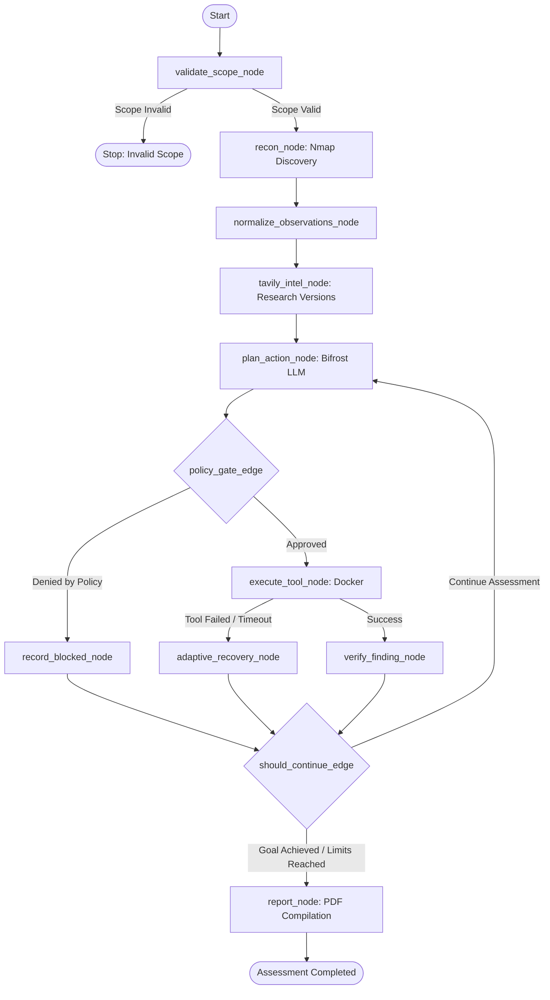

# Module 02 — Agent Orchestrator & Adaptive Recovery

**Module ID:** `agent-orchestrator`  
**Status:** Approved Specification  
**Primary Owner:** Dev 1  
**Dependencies:** `core-scope`, `tool-engine`, `bifrost-gateway`, `finding-verifier`  
**Downstream Consumers:** `api-lifecycle`, `report-engine`  

---

## 1. Overview & Architectural Role

The **Agent Orchestrator** governs the autonomous assessment loop using **LangGraph**. It replaces chaotic multi-agent swarms with a single, stateful, deterministic-governed workflow.

Key principles:
1. **The LLM Proposes, Deterministic Code Disposes:** The LLM only generates typed `ActionProposal` structures. Deterministic policy controls whether they run.
2. **Bounded Adaptive Recovery:** Failures (timeouts, non-zero exits, network resets) trigger structured recovery instead of infinite loops or crashes.
3. **Artifact-Referenced State:** Heavy raw logs never enter the LLM context or LangGraph state; only lightweight observation summaries and cryptographic `evidence_id` references are retained.

---

## 2. Complete State Schema (`engine/state.py`)

```python
from typing import TypedDict, List, Dict, Any, Optional

class AssessmentState(TypedDict):
    # Assessment Metadata
    assessment_id: str
    target: Dict[str, Any]             # {"type": "web" | "network", "value": "http://lab:8080"}
    scope_id: str
    scope_version: str
    status: str                         # DRAFT | VALIDATING | READY | RUNNING | PAUSED | COMPLETED | FAILED

    # Topology & Knowledge Base
    discovered_assets: List[str]        # ["192.168.100.5", "lab-target.local"]
    discovered_services: List[Dict[str, Any]] # [{"port": 8080, "service": "http", "version": "Apache 2.4.49"}]
    observations: List[Dict[str, Any]]  # Normalized observation summaries
    research_refs: List[Dict[str, Any]] # Tavily retrieved CVEs, patch URLs, advisory summaries

    # Execution & Test Planning
    test_plan: List[Dict[str, Any]]
    current_action: Optional[Dict[str, Any]] # Active ActionProposal
    executed_actions: List[Dict[str, Any]]
    blocked_actions: List[Dict[str, Any]]

    # Findings & Evidence Registry
    evidence_refs: List[Dict[str, Any]] # List of {"evidence_id": "...", "sha256": "..."}
    findings: List[Dict[str, Any]]      # Verified & potential findings

    # Execution Limits & Health State
    current_iteration: int
    max_iterations: int
    started_at: str
    deadline_at: Optional[str]
    consecutive_failures: int
    last_error: Optional[Dict[str, Any]]
    stop_reason: Optional[str]
```

---

## 3. LangGraph Workflow Graph



---

## 4. Structured Action Proposal Schema (`packages/contracts/actions.py`)

The LLM is prompted to return an explicit Pydantic JSON structure:

```python
from pydantic import BaseModel, Field
from typing import Dict, Any, Optional

class ActionProposal(BaseModel):
    action_id: str = Field(description="Unique action ID, e.g. act-003")
    target_host: str = Field(description="Target hostname or IP address")
    target_port: Optional[int] = Field(None, description="Target port number")
    tool_name: str = Field(description="Registered tool name: nmap, zap, or nuclei")
    action_category: str = Field(description="network_recon, web_crawl, passive_vuln_scan, active_template_check")
    arguments: Dict[str, Any] = Field(description="Typed arguments for the tool adapter")
    rationale: str = Field(description="Explanation of why this action is required")
    expected_evidence: str = Field(description="What evidence will prove/disprove the hypothesis")
    timeout_seconds: int = Field(default=120, description="Execution timeout limit")
```

---

## 5. Bounded Adaptive Recovery Policy

When a tool fails (timeout, exit code $\neq 0$, parse failure), `adaptive_recovery_node` executes deterministic recovery:

| Failure Type | Detection Criteria | Recovery Action | Max Retries |
|---|---|---|---|
| **Tool Timeout** | Execution exceeds `timeout_seconds` | Terminate process with `SIGKILL`. Record timeout event. Replan with smaller port range or faster template. | 1 retry |
| **Non-Zero Exit Code** | Tool process exits with code $\neq 0$ | Capture stderr. If missing dependency, fail task. If target connection reset, record host unreachable and update state. | 1 retry |
| **Malformed Output** | Output parser raises XML/JSON parse exception | Save raw artifact as evidence, tag `PARSE_ERROR`, extract partial raw lines, and notify LLM to select alternative check. | 0 retries (Safe Replan) |
| **Policy Block** | Scope policy rejects proposed action | Add action to `blocked_actions` list. Feed rejection reason back into LLM prompt on next iteration. | No retry |
| **Bifrost Provider Outage** | Bifrost returns HTTP 500/503 | Bifrost automatically routes to secondary provider (Claude $\rightarrow$ GPT-4o). If all fail, save SQLite checkpoint and set state to `PAUSED`. | 2 retries |

---

## 6. Prompt Engineering & Bifrost System Prompt

System prompts avoid exposing raw chain-of-thought to the frontend while enforcing strict structured outputs:

```python
SYSTEM_PROMPT = """You are the ARGUS Autonomous Security Testing Agent.
Your objective is to assess the authorized lab target and identify vulnerabilities within the strict scope provided.

RULES:
1. You may only select tools from the registered list: [nmap, zap, nuclei].
2. You must never attempt shell escapes, command injection, or denial of service.
3. Every proposed action must be backed by an observation from previous steps.
4. Output your decision strictly as a JSON object matching the ActionProposal schema.
5. If the lab objective is satisfied, set action_category to 'complete_assessment'.
"""
```

---

## 7. Acceptance Criteria & Test Scenarios

1. `test_graph_compiles`: LangGraph `StateGraph` compiles without cycles or missing edges.
2. `test_recon_to_plan_transition`: Completing recon automatically moves state to action planning.
3. `test_timeout_recovery`: Simulated 180s tool freeze aborts child process, increments `consecutive_failures`, and triggers replan.
4. `test_iteration_limit_enforced`: Reaching `max_iterations` cleanly transitions graph to `report_node`.

