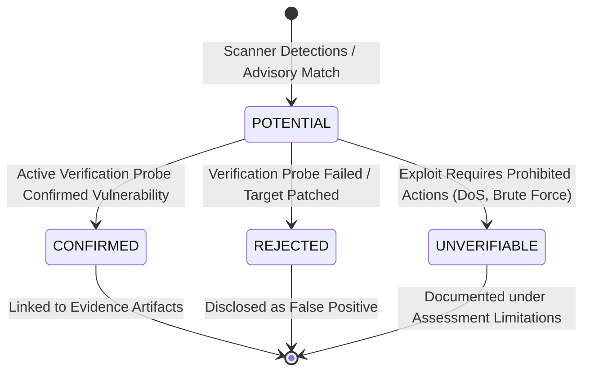

# Module 04 — Evidence Vault & Finding Verification

**Module ID:** `evidence-vault` / `finding-verifier`  
**Status:** Approved Specification  
**Primary Owner:** Dev 1  
**Dependencies:** None  
**Downstream Consumers:** `agent-orchestrator`, `api-lifecycle`, `report-engine`  

---

## 1. Overview & Architectural Role

The **Evidence Vault & Finding Verification Engine** solves the single biggest issue in autonomous security agents: **hallucinated, unverified vulnerabilities**.

Core principles:
1. **Cryptographic Integrity:** Every raw tool execution result is written to an immutable disk artifact with a calculated SHA-256 digest.
2. **Scanner Output $\neq$ Confirmed Finding:** Detections from scanners (ZAP, Nmap banners) start as `POTENTIAL`. They are elevated to `CONFIRMED` only after independent verification reproduces the behavior.
3. **Secret Redaction:** Passwords, API tokens, and authorization headers are scrubbed before storage and report rendering.

---

## 2. Evidence Vault File Layout & Schema

### 2.1 File Storage Hierarchy
```
/artifacts/
└── {assessment_id}/
    ├── ev-20261104-001.raw       <- Raw Nmap XML output
    ├── ev-20261104-002.raw       <- Raw Nuclei JSONL output
    ├── ev-20261104-003.raw       <- HTTP request & response dump
    └── metadata.jsonl            <- Append-only log of artifact hashes
```

### 2.2 Pydantic Evidence Metadata Schema
```python
from pydantic import BaseModel
from datetime import datetime
from typing import Optional, Dict, Any

class EvidenceArtifact(BaseModel):
    evidence_id: str             # e.g., "ev-20261104-a1b2c3"
    assessment_id: str
    tool_name: str               # "nmap" | "zap" | "nuclei" | "http_probe"
    tool_version: str            # "nmap-7.94"
    command_executed: str        # Redacted command string
    sha256: str                  # Cryptographic SHA-256 hex digest
    file_path: str               # Local disk path
    captured_at: datetime
    content_type: str            # "application/xml" | "application/json" | "text/plain"
    redacted: bool               # True if sensitive tokens were masked
    metadata: Dict[str, Any]     # Target, port, status code, latency
```

---

## 3. Cryptographic Hashing & Redaction Pipeline (`core/evidence/evidence_vault.py`)

```python
import hashlib
import re
from pathlib import Path
from datetime import datetime

SECRET_PATTERNS = [
    re.compile(r'(?i)(bearer\s+)[a-zA-Z0-9_\-\.]{20,}'),
    re.compile(r'(?i)(password\s*[:=]\s*)[^\s&,;]{3,}'),
    re.compile(r'(?i)(apikey\s*[:=]\s*)[a-zA-Z0-9_\-]{20,}'),
    re.compile(r'(?i)(authorization:\s*basic\s+)[a-zA-Z0-9+/=]+')
]

class EvidenceVault:
    def __init__(self, base_dir: Path):
        self.base_dir = base_dir

    def store_artifact(self, assessment_id: str, tool_name: str, raw_content: str, cmd: str) -> EvidenceArtifact:
        # 1. Redact Sensitive Tokens
        redacted_content, was_redacted = self._redact_secrets(raw_content)

        # 2. Compute SHA-256 Digest
        sha256_hash = hashlib.sha256(redacted_content.encode("utf-8")).hexdigest()

        # 3. Write File
        artifact_dir = self.base_dir / assessment_id
        artifact_dir.mkdir(parents=True, exist_ok=True)
        evidence_id = f"ev-{datetime.utcnow().strftime('%Y%m%d%H%M%S')}-{sha256_hash[:6]}"
        file_path = artifact_dir / f"{evidence_id}.raw"

        file_path.write_text(redacted_content, encoding="utf-8")

        return EvidenceArtifact(
            evidence_id=evidence_id,
            assessment_id=assessment_id,
            tool_name=tool_name,
            tool_version="1.0.0",
            command_executed=cmd,
            sha256=sha256_hash,
            file_path=str(file_path),
            captured_at=datetime.utcnow(),
            content_type="text/plain",
            redacted=was_redacted,
            metadata={"file_size_bytes": len(redacted_content)}
        )

    def _redact_secrets(self, text: str) -> tuple[str, bool]:
        redacted = text
        changed = False
        for pattern in SECRET_PATTERNS:
            if pattern.search(redacted):
                redacted = pattern.sub(r'\1[REDACTED_BY_ARGUS]', redacted)
                changed = True
        return redacted, changed
```

---

## 4. Finding Verification State Machine



### Finding Schema (`packages/contracts/findings.py`)
```python
from pydantic import BaseModel
from typing import List, Optional
from datetime import datetime

class Finding(BaseModel):
    finding_id: str              # "find-20261104-01"
    assessment_id: str
    title: str                   # "Path Traversal in Apache HTTP Server (CVE-2021-41773)"
    description: str             # Detailed technical description
    severity: str                # "INFORMATIONAL" | "LOW" | "MEDIUM" | "HIGH" | "CRITICAL"
    confidence: str              # "CONFIRMED" | "POTENTIAL" | "REJECTED" | "UNVERIFIABLE"
    affected_asset: str          # "http://192.168.100.5:8080"
    affected_service: str        # "Apache 2.4.49"
    verification_method: str     # "Nuclei CVE-2021-41773 template match with HTTP 200 /etc/passwd disclosure"
    reproduction_steps: str      # Exact curl command to reproduce safely
    impact: str                  # Technical & business risk
    remediation: str             # Tavily-sourced patch guidance
    evidence_ids: List[str]      # Hashed links to raw evidence files
    research_source_ids: List[str] # Tavily citation IDs
    created_at: datetime
```

---

## 5. Acceptance Criteria & Test Scenarios

1. `test_sha256_integrity`: Modifying an artifact on disk causes integrity check verification failure.
2. `test_secret_redaction`: Raw input containing `Bearer eyJ...` or `password: admin123` is scrubbed to `[REDACTED_BY_ARGUS]`.
3. `test_finding_confirmation_requires_evidence`: Promoting a finding to `CONFIRMED` without an attached `evidence_id` raises a validation error.
4. `test_unverifiable_downgrade`: Finding requiring DoS or brute force is strictly assigned status `UNVERIFIABLE`.

