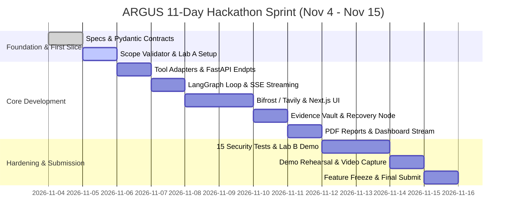

# Module 09 — Team Plan, Milestones & Submission Checklist

**Module ID:** `plan-and-milestones`  
**Status:** Approved Specification  
**Primary Owner:** Dev 1 & Dev 2 (Shared)  
**Dependencies:** All modules  

---

## 1. Two-Person Ownership & Division of Labor

To maximize execution velocity during the 11-day hackathon window, responsibilities are partitioned cleanly across architectural boundaries:

```
┌───────────────────────────────────────────────┐  ┌───────────────────────────────────────────────┐
│ DEVELOPER 1: Security Engine & AI Agent       │  │ DEVELOPER 2: Platform, API & Dashboard        │
├───────────────────────────────────────────────┤  ├───────────────────────────────────────────────┤
│ • Module 01: Scope & Safety Policy Engine     │  │ • Module 06: FastAPI CRUD & REST Endpoints    │
│ • Module 02: LangGraph Agent & Recovery Nodes │  │ • Module 06: SQLite Database Schema & WAL     │
│ • Module 03: Tool Adapters (Nmap/ZAP/Nuclei)  │  │ • Module 06: Server-Sent Events (SSE) Stream  │
│ • Module 04: Evidence Vault & Finding Verifier│  │ • Module 07: Next.js 15 App Router Frontend   │
│ • Module 05: Bifrost Model Gateway Integration│  │ • Module 07: Live Assessment Room UI          │
│ • Module 05: Tavily CVE Intelligence Pipeline │  │ • Module 07: PDF Report Generator (WeasyPrint)│
│ • Module 08: 15 Security Test Scenarios       │  │ • Module 08: Docker Compose & Lab Environments│
└───────────────────────────────────────────────┘  └───────────────────────────────────────────────┘
```

### Team Integration Protocols
1. **Pydantic Contracts First:** Pydantic schemas in `packages/contracts/` serve as the single source of truth. Neither developer may alter contract schemas without prior mutual review.
2. **Daily Integration Checkpoint:** Merges occur daily at 18:00. No PR may be merged if pytest fails or coverage drops.
3. **End-to-End Rule:** A feature is considered done only when it executes end-to-end through the API, produces an evidence artifact, and updates the database.

---

## 2. Eleven-Day Execution Schedule (Nov 4 – Nov 15, within the Nov 1–15 submission window)



### Day-by-Day Deliverables

| Date | Primary Target Deliverable | Verification Milestone |
|---|---|---|
| **Nov 4** | Monorepo layout, Pydantic contracts, Scope YAML schema, Lab A. | `pytest tests/contracts` passes. |
| **Nov 5** | Scope validator, deterministic policy engine, Docker tool runner. | Out-of-scope IP test is blocked. |
| **Nov 6** | Nmap & Nuclei adapters, normalized observation parser, FastAPI CRUD. | Tool runs inside Docker and outputs JSON. |
| **Nov 7** | LangGraph agent loop, Bifrost model proxy integration, SSE stream. | Agent proposes action and executes it via Docker. |
| **Nov 8** | ZAP baseline scan adapter, Next.js Dashboard & Assessment Launcher. | Frontend creates assessment and triggers backend. |
| **Nov 9** | Tavily CVE research integration, Evidence Vault SHA-256 storage. | Evidence file saved with computed digest. |
| **Nov 10**| Bounded adaptive recovery loop, tool timeout handling, replanning. | Injected tool freeze recovers cleanly. |
| **Nov 11**| Live Assessment Room UI with real-time SSE event feed, Bifrost bar. | Real-time audit log displays agent actions. |
| **Nov 12**| PDF report generation with WeasyPrint, Bifrost provider fallback. | Downloadable PDF with verified findings and citations. |
| **Nov 13**| Multi-host Lab B setup, running all 15 automated security scenarios. | 15/15 test suite passes in CI. |
| **Nov 14**| End-to-end demo rehearsal, screen recording, README documentation. | Clean start to finish demo in < 3 minutes. |
| **Nov 15**| Code freeze, final repository verification, hackathon submission. | Submission entered before deadline. |

---

## 3. The First 48-Hour Critical Vertical Slice

Before building any frontend components, the team must prove the vertical slice end-to-end:

1. [x] Create repository structure and dependencies (`pyproject.toml`, `package.json`).
2. [x] Agree on Pydantic schemas (`AssessmentCreate`, `ActionProposal`, `Finding`, `EvidenceArtifact`).
3. [ ] Implement `core/scope/validator.py` and `policy_engine.py`.
4. [ ] Launch isolated Docker container for Lab A (`cve-2021-41773-lab`).
5. [ ] Execute one real Nmap scan via `ToolRegistry` in Docker against Lab A.
6. [ ] Save raw scan output to disk, compute SHA-256 digest, and normalize observations.
7. [ ] Run automated test proving an action against an unauthorized IP is blocked.
8. [ ] Commit the verified vertical slice.

> **Rule:** If this slice is not functional by the end of Day 2, reduce feature scope immediately.

---

## 4. Final Submission Checklist

### 4.1 Product & Architecture
- [ ] Reproducible `docker compose up` that starts API, Web UI, Tool Runner, and Lab A.
- [ ] Clean GitHub repository with comprehensive README, setup instructions, and architecture diagrams.
- [ ] Explicit selection of **Track A: Challenge 03 (Autonomous Pentesting Agent)**.
- [ ] Active Bifrost telemetry dashboard showcasing multi-provider fallback.
- [ ] Active Tavily search integration displaying authoritative CVE citations.

### 4.2 Safety & Governance
- [ ] Zero out-of-scope packets transmitted across all test runs.
- [ ] Scope document validation required before any tool executes.
- [ ] 100% of confirmed findings linked to cryptographic SHA-256 evidence files.
- [ ] Passwords, tokens, and authorization headers redacted from all stored artifacts.
- [ ] No unrestricted bash/shell execution permitted.

### 4.3 Demonstration & Submission
- [ ] 3-minute video walkthrough rehearsed and recorded.
- [ ] Client-ready sample PDF report included in `/docs/sample_report.pdf`.
- [ ] Repository submitted to the official hackathon portal prior to the November 15 deadline.

