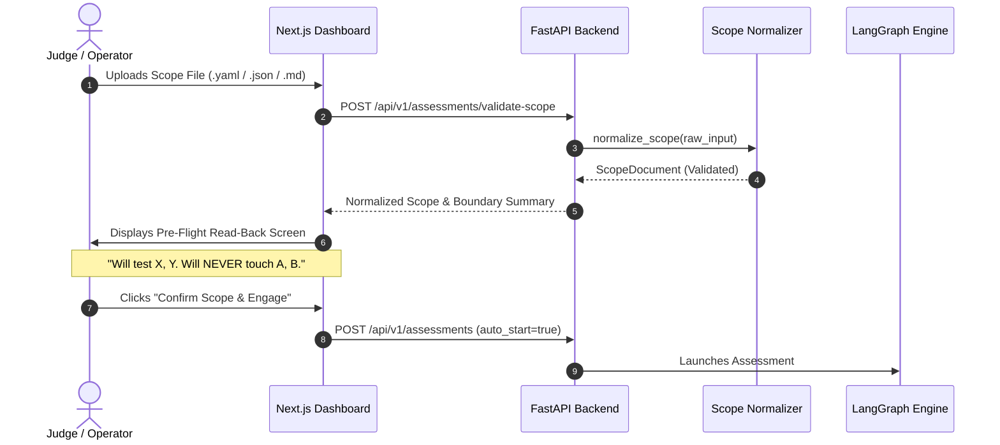
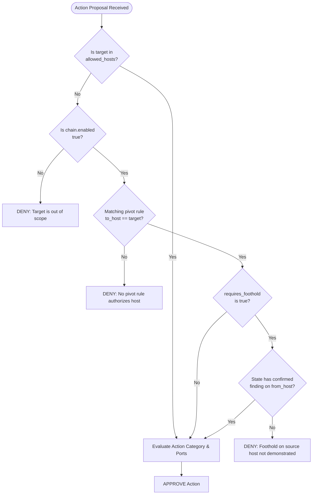

# Module 10 — Implementation Review, Safety Hardening & Judging Readiness Plan

**Module ID:** `judging-readiness-and-remediation`  
**Status:** Approved Specification & Implementation Roadmap  
**Primary Owners:** Dev 1 (Policy, Engine, Test Harness) & Dev 2 (API, Frontend, Reporting)  
**Dependencies:** Modules 00, 01, 02, 03, 04, 06, 07, 08, 11  

---

## 1. Executive Summary & Context

Following an architectural review of the ARGUS autonomous security platform against the Geek Room / Global AI Hackathon (Track A: Challenge 03) evaluation criteria, this specification documents the critical gaps between the working MVP and judging-day requirements.

While ARGUS possesses an exceptional defensive foundation—featuring an out-of-model policy firewall, a verify-before-report state node, and an append-only SHA-256 evidence vault—the review identified key operational and architectural vulnerabilities:
1. **Input Friction:** Reliance on a manual dashboard form rather than a flexible scope file ingestion pipeline.
2. **Safety Architecture Clarification:** Moving away from documentation claiming "string blocklists" to strictly verified capability-constrained tool execution.
3. **Multi-Host & Lateral Movement:** The lack of a true multi-host trace with directed pivot edges and precondition foothold gating.
4. **Recon Discovery Handling:** Preventing turn waste on out-of-scope discoveries.
5. **Auditable Scope Compliance:** Replacing passive assertions of "zero out-of-scope packets" with active, falsifiable firewall denial proofs in the final deliverable.

This document establishes the single source of truth for resolving each gap.

---

## 2. Comprehensive Problem & Solution Breakdown

```
┌────────────────────────────────────────────────────────────────────────────────────────┐
│                               ARCHITECTURAL GAPS & SOLUTIONS                           │
├───────────────────────────────────┬────────────────────────────────────────────────────┤
│ 1. Scope Ingestion & Validation   │ Multi-format file importer + Pre-flight Read-Back  │
│ 2. Tool Safety Model              │ Immutable pre-pinned templates (zero freeform SQL) │
│ 3. Lateral Movement Architecture  │ Unified directed ChainConfig with PivotRule edges  │
│ 4. Pivot Authorization Gate       │ Precondition check: Verified foothold required     │
│ 5. Discovery Boundary Guard       │ Upfront scope filter on newly discovered hosts     │
│ 6. Auditable Deliverable Proof    │ Active firewall interception log + Merkle root     │
│ 7. Multi-Host Test Coverage       │ End-to-end integration test with seeded perimeter  │
│ 8. Documentation & Tone Hygiene   │ Sober, evidence-first language & sanitized docs    │
└───────────────────────────────────┴────────────────────────────────────────────────────┘
```

---

### Problem 1: Scope Ingestion & Judging Day Operator Flow

#### The Problem
The current UI requires operators to type a target URL, subnet, and safety tier into a form. On judging day, evaluators will supply an arbitrary scope file (YAML, JSON, or Markdown/plain text). Manually copying and pasting fields during a live evaluation is slow, brittle, and introduces operator error at the highest-stakes moment.

#### The Solution
1. **Multi-Format Scope Ingestion:** 
   Add a file import zone to the Next.js assessment launcher (`apps/web/src/app/new/page.tsx`) that accepts `.yaml`, `.yml`, `.json`, `.md`, and `.txt`.
2. **Robust Ingestion Pipeline:** 
   The backend [`normalize_scope()`](file:///Users/ajaysingh/Documents/Open-source/argus/packages/contracts/scope.py) normalizes loose structures (CIDRs, host:port, IPv6 literals, URL strings, and target lists) into a validated [`ScopeDocument`](file:///Users/ajaysingh/Documents/Open-source/argus/packages/contracts/scope.py).
3. **Pre-Flight Scope Read-Back Screen:** 
   Prior to dispatching `POST /api/v1/assessments`, the UI renders an uneditable, high-contrast confirmation summary:
   - **Authorized Entry Targets:** `[192.168.100.5:8080]`
   - **Authorized Pivot Edges:** `192.168.100.5 ➔ 192.168.100.10` *(Requires Foothold)*
   - **Strictly Prohibited Targets:** Gateway `192.168.100.1`, Metadata `169.254.169.254`, Ports `22, 25, 445`
   - **Action Envelope:** `network_recon`, `active_template_check`
   - Explicit **"Confirm Scope & Engage"** button.



---

### Problem 2: Tool Safety Architecture (The SQLi / Destructive Payload Question)

#### The Problem
Early documentation in `PROJECT_EXPLAINED.md` casually stated:
> *"Blocks destructive patterns (`DROP TABLE`, `UNION SELECT password`, `rm -rf`, `format`)."*

This implied ARGUS was generating freeform SQL or shell strings via an LLM and filtering them through a regex string blocklist. As the reviewer noted, string blocklists are trivially bypassed via encoding, case manipulation, or whitespace tricks. A judge testing safety claims will aggressively probe freeform inputs.

#### The Solution: Capability-Constrained Execution by Construction
In the actual implementation, **ARGUS does not generate freeform SQL or arbitrary shell commands.** All active exploitation and vulnerability verification is mediated exclusively through capability-constrained adapters:

1. **Immutable Pre-Pinned Templates (NucleiAdapter):**
   - Active vulnerability verification is handled by [`NucleiAdapter`](file:///Users/ajaysingh/Documents/Open-source/argus/integrations/tools/nuclei_adapter.py).
   - The LLM only proposes *which* pre-vetted template to execute (e.g. `cve-2021-41773.yaml` or a safe version disclosure check).
   - The adapter strictly validates that `template` has no directory traversal (`..`), is a relative `.yaml` filename, and resolves exclusively within a local, read-only directory (`/templates/pinned/`).
2. **Subprocess Argv Dispatch (No Shell):**
   - All tool commands are dispatched as discrete argument vectors (`argv: list[str]`) using `subprocess.run(argv, shell=False)`.
   - Shell metacharacters (`;`, `&&`, `|`, `` ` ``, `$()`) are impossible to execute because no shell interpreter is invoked.
3. **Safe Output Parsing:**
   - Nmap XML is parsed with `defusedxml` to neutralize XXE vulnerabilities.
   - Nuclei JSONL is parsed with native `json.loads`.
4. **Documentation Correction:**
   - Remove references to "string blocklists" in docs. Formally document **"Safety by Capability Constraint and Immutable Templates"**.

---

### Problem 3: Multi-Host Architecture & Unified Directed Chain Schema

#### The Problem
Currently, `ScopeDocument` contains two potentially overlapping concepts:
1. `authorized_chain`: Linear sequence steps (`ChainStepConfig`).
2. `lateral_movement`: Discussed as a parallel block.

Having two separate structures invites split-brain authorization bugs. Additionally, if the internal pivot host (e.g., `192.168.100.10`) is listed directly in `targets.allowed_hosts`, it is authorized from iteration 1, bypassing the pivot logic completely.

#### The Solution: Unified `ChainConfig` with `PivotRule` Edges
Unify all multi-step and lateral movement authorization into a single, cohesive contract in [`packages/contracts/scope.py`](file:///Users/ajaysingh/Documents/Open-source/argus/packages/contracts/scope.py):

```python
class PivotRule(BaseModel):
    """Explicit directed edge representing an authorized lateral movement pivot."""
    model_config = ConfigDict(frozen=True, extra="forbid")

    from_host: str = Field(..., description="Source host where a verified foothold must already exist")
    to_host: str = Field(..., description="Destination internal host unlocked by this pivot")
    allowed_ports: list[int] = Field(default_factory=list, description="Authorized destination ports")
    allowed_categories: list[str] = Field(
        default_factory=lambda: ["network_recon", "active_template_check"],
        description="Authorized action categories against destination host"
    )
    requires_foothold: bool = Field(
        default=True,
        description="Whether a confirmed finding/evidence on from_host is required"
    )
    min_severity: str = Field(
        default="HIGH",
        description="Minimum finding severity on from_host required to unlock the pivot"
    )

class ChainConfig(BaseModel):
    """Unified bounded multi-step chain and lateral movement envelope."""
    model_config = ConfigDict(frozen=True, extra="forbid")

    enabled: bool = Field(
        default=False, 
        description="Whether multi-step chained actions and pivots are authorized"
    )
    max_depth: int = Field(default=3, ge=1, le=5, description="Maximum pivot depth")
    entry_hosts: list[str] = Field(
        default_factory=list,
        description="Initial perimeter hosts authorized for direct testing"
    )
    pivots: list[PivotRule] = Field(
        default_factory=list,
        description="Authorized directed edges between hosts"
    )
```

#### Scope Authoring Rule:
The internal pivot target (`192.168.100.10`) **MUST NOT** be placed in `targets.allowed_hosts`. It must appear exclusively in `chain.pivots[].to_host`.

---

### Problem 4: Foothold Precondition Gating in `PolicyEngine`

#### The Problem
If `PolicyEngine` only performs a static config lookup (`does edge .5 -> .10 exist?`), the agent could jump directly to `.10` on iteration 1 without ever testing or compromising `.5`. That undercuts the "multi-step movement where explicitly allowed" requirement.

#### The Solution: State-Conditioned Policy Evaluation
When [`PolicyEngine.evaluate()`](file:///Users/ajaysingh/Documents/Open-source/argus/core/policy/policy_engine.py) receives an `ActionProposal` targeting a host:

1. **Direct Entry Check:** 
   If `target_host in scope.targets.allowed_hosts`:
   `APPROVED` (Perimeter host authorized from start).
2. **Pivot Edge Check:** 
   If `target_host` is not in `allowed_hosts`:
   - Search `scope.chain.pivots` for a rule where `rule.to_host == target_host`.
   - If no matching rule exists: `DENIED` (`"Host is outside authorized perimeter and no pivot edge authorizes it."`).
   - If a matching rule exists:
     - Check if `rule.requires_foothold` is `True`.
     - Inspect `state["findings"]` and `state["evidence_refs"]`.
     - Verify that `rule.from_host` has at least one finding with `confidence == "CONFIRMED"` and severity $\ge$ `rule.min_severity`.
     - **If foothold condition is NOT met:** `DENIED`:
       > *"Pivot to 192.168.100.10 rejected: Required foothold on 192.168.100.5 has not been demonstrated with verified evidence."*
     - **If foothold condition IS met:** `APPROVED` (Pivot unlocked by verifiable compromise).



---

### Problem 5: Upfront Scope Re-Validation on Recon Discovery

#### The Problem
When Nmap or crawler actions discover unexpected hosts or subdomains, they are currently stored in `state["discovered_assets"]`. When the LLM planner reads these assets, it proposes actions against them. Although `PolicyEngine` successfully blocks the execution, this burns an iteration budget turn and clutters the run with avoidable failures.

#### The Solution: Discovery Boundary Sanitization
In [`engine/graph.py`](file:///Users/ajaysingh/Documents/Open-source/argus/engine/graph.py#L532-L557) (`normalize_observations_node`):
1. For every newly discovered host or IP extracted from tool output:
   - Run a pre-check: `is_valid_target = self.policy_engine.is_target_authorized(host)`
   - If in-scope (or matching an authorized pivot destination): Add to `state["discovered_assets"]`.
   - If out-of-scope: Add to `state["unauthorized_discovered_assets"]` and emit an audit event:
     `"Asset 192.168.100.99 discovered via recon but excluded from scope. Will NOT be targeted."`
2. The planning prompt only receives authorized discovered assets.

---

### Problem 6: Demonstrable Scope Compliance in the Report Deliverable

#### The Problem
A report claiming "0 out-of-scope packets were sent" is passive and unfalsifiable. To an auditor or judge, it looks like nothing was ever tested. Evaluators want to see the safety firewall actively catching and stopping unauthorized actions.

#### The Solution: Active Interceptions & Boundary Attestation Section
In [`core/reporting/report_generator.py`](file:///Users/ajaysingh/Documents/Open-source/argus/core/reporting/report_generator.py), create a dedicated **Section 1.5: Scope Compliance & Active Boundary Attestation**:

1. **Enforcement Telemetry Card:**
   - Total Action Proposals Evaluated: `14`
   - Authorized & Executed: `11`
   - Intercepted & Blocked: `3` (100% fail-closed)
   - Cryptographic Ledger Root: `sha256:4a8b...`
2. **Deterministic Interception Table:**
   Explicitly tabulate every prevented action:

   | Timestamp (UTC) | Proposed Tool | Target | Policy Rule Triggered | Prevention Status |
   |:---|:---|:---|:---|:---|
   | `2026-11-06T14:10:02Z` | `nmap` | `192.168.100.1:80` | Subnet gateway explicitly denied in `targets.denied_hosts` | **BLOCKED (0 packets sent)** |
   | `2026-11-06T14:12:18Z` | `nuclei` | `192.168.100.10:22` | Pivot rejected: no foothold demonstrated on `192.168.100.5` | **BLOCKED (0 packets sent)** |
   | `2026-11-06T14:15:40Z` | `nmap` | `169.254.169.254:80` | Cloud metadata IP prohibited by SSRF boundary rule | **BLOCKED (0 packets sent)** |

3. **Seeded Test Fixtures:**
   Our test fixtures will deliberately include a discoverable gateway (`192.168.100.1`) and an out-of-scope host (`192.168.100.99`) so the report demonstrably proves the firewall fired.

---

### Problem 7: Multi-Host Pivot Integration Test Trace

#### The Problem
ARGUS has unit and scenario tests for single-host targets (Apache 2.4.49 path traversal, Lab B multi-service FTP/SSH), but lacked an end-to-end multi-host lateral movement integration test.

#### The Solution: `tests/integration/test_multihost_pivot.py`
Create an integration test exercising the complete 4-phase lateral movement lifecycle:

```
[Phase 1: Perimeter Recon] ──► [Phase 2: Premature Pivot Denied] ──► [Phase 3: Foothold Established] ──► [Phase 4: Pivot Approved]
   Target: 192.168.100.5             Target: 192.168.100.10             Target: 192.168.100.5             Target: 192.168.100.10
   Result: Discovered 8080           Result: BLOCKED (No Foothold)      Result: CONFIRMED Finding         Result: SUCCESS (Recon on .10)
```

**Test Verification Assertions:**
1. Action on `192.168.100.5` succeeds.
2. Premature action on `192.168.100.10` fails closed with policy denial.
3. Exploitation on `.5` registers confirmed finding with SHA-256 evidence.
4. Second action on `.10` succeeds because the foothold precondition is satisfied.
5. Report generator outputs the traversal graph and the interception log.

---

### Problem 8: Documentation, Tone & Credential Hygiene

#### The Problem
Marketing language such as "zero hallucinations" and "Cyber Command Center" undermines technical credibility. Additionally, placeholder tokens like `sk-bf-local` or documentation typos (wildcard CORS) can raise red flags with judges.

#### The Solution:
1. **Tone Realism:** 
   Replace "zero hallucinations" with the defensible engineering claim: **"Deterministic pre-report verification: no unverified finding reaches the final deliverable."**
2. **Configuration Alignment:** 
   Update `PROJECT_EXPLAINED.md` to match the actual code: CORS is restricted to `["http://localhost:3000", "http://127.0.0.1:3000"]`.
3. **Secret Sanitization:** 
   Ensure all examples use standard RFC dummy values (`sk-bf-dummy-key`, `192.0.2.1`).

---

## 3. Data Contracts & Schema Reference

### Complete Multi-Host Scope Document (`scope.yaml`)
```yaml
schema_version: "1.0"
assessment_id: "asm-judge-multihost-pivot"
name: "Authorized Multi-Host Lateral Movement Assessment"

# Perimeter entry target ONLY
targets:
  allowed_hosts:
    - "192.168.100.5"
  allowed_subnets:
    - "192.168.100.0/24"
  denied_hosts:
    - "192.168.100.1"   # Default Gateway (Always Denied)
    - "169.254.169.254" # Cloud Metadata (Always Denied)

ports:
  allowed_ports: [80, 8080, 22, 3306]
  denied_ports: [25, 445]

actions:
  allowed_categories:
    - "network_recon"
    - "web_crawl"
    - "active_template_check"

# Unified chain and lateral movement envelope
chain:
  enabled: true
  max_depth: 2
  entry_hosts:
    - "192.168.100.5"
  pivots:
    - from_host: "192.168.100.5"
      to_host: "192.168.100.10" # Internal target reachable ONLY via pivot
      allowed_ports: [22, 3306]
      allowed_categories:
        - "network_recon"
        - "active_template_check"
      requires_foothold: true
      min_severity: "HIGH"

network_policy:
  redirect_policy: "in_scope_only"
  allow_external_dns: false
```

---

## 4. Implementation Roadmap & Acceptance Checklist

### Phase 1: Contract & Policy Engine Hardening (Day 1)
- [ ] Update `packages/contracts/scope.py`: Define `PivotRule`, `ChainConfig`, and update `normalize_scope()`.
- [ ] Update `core/policy/policy_engine.py`: Add `has_verified_foothold()` check for pivot rules.
- [ ] Add unit tests in `tests/security/test_scope_firewall.py` verifying edge gating and premature pivot rejection.

### Phase 2: Orchestrator Discovery Filter & Multi-Host Test (Day 2)
- [ ] Update `engine/graph.py`: Filter newly discovered hosts in `normalize_observations_node`.
- [ ] Implement `tests/integration/test_multihost_pivot.py`: Validate the full 4-phase compromise-and-pivot trace.
- [ ] Seed fixtures with gateway `192.168.100.1` and out-of-scope `192.168.100.99`.

### Phase 3: Reporting Deliverable & Active Interception Table (Day 3)
- [ ] Update `core/reporting/report_generator.py`: Add Section 1.5 *"Scope Compliance & Active Boundary Attestation"*.
- [ ] Add table of intercepted actions with timestamps and policy reasons.
- [ ] Embed the Merkle ledger root and T1/T2 proof status.

### Phase 4: UI Scope Importer & Pre-Flight Read-Back (Day 4)
- [ ] Update `apps/web/src/app/new/page.tsx`: Add drag-and-drop file upload for YAML, JSON, and Markdown.
- [ ] Implement Pre-Flight Scope Read-Back summary card before launching assessment.
- [ ] Clean up documentation in `PROJECT_EXPLAINED.md` and `README.md` (tone, CORS, and capabilities).

---

## 5. Acceptance Criteria

| Requirement | Success Verification |
|:---|:---|
| **Scope Ingestion** | Uploading `.yaml`, `.json`, or `.md` parses cleanly and renders the Pre-Flight Read-Back summary. |
| **Premature Pivot Prevention** | Proposing an action against an internal host before compromising the perimeter returns a deterministic policy denial (`403` / `approved=False`). |
| **Pivot Unlock** | Establishing a verified `HIGH` or `CRITICAL` finding on the perimeter host immediately unlocks the authorized pivot edge to the internal host. |
| **Discovery Sanitization** | Discovered out-of-scope IPs are logged in audit telemetry and never suggested to the LLM planner. |
| **Report Verification** | The generated report contains the Active Interceptions table and the Merkle ledger root proving boundary compliance. |
| **Zero Regressions** | Full test suite passes (`pytest -q tests/` 100% pass rate). |

